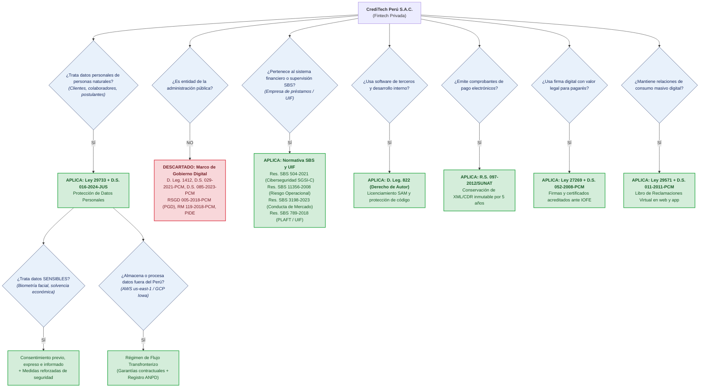
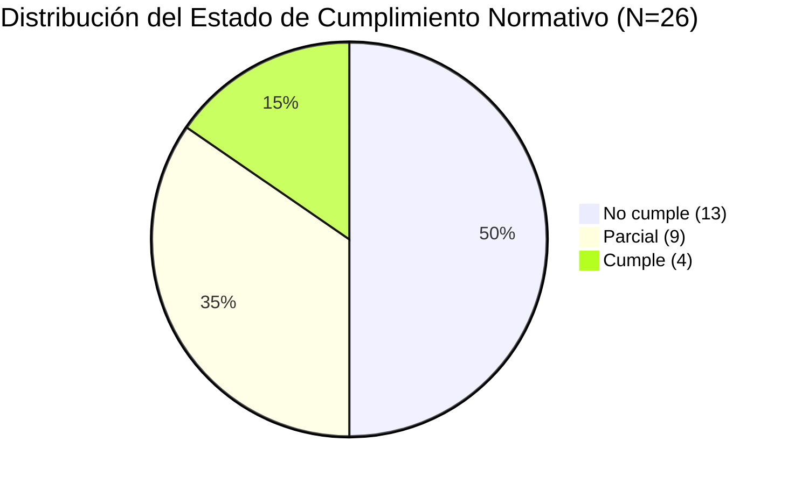

# Sección 4.1 · Marco Normativo Aplicable y Matriz de Cumplimiento

---

## 4.1 Marco normativo aplicable

El Plan Estratégico de Tecnologías de la Información (PETI) de **CrediTech Perú S.A.C.** no opera en un vacío normativo ni se restringe a aspiraciones discrecionales del negocio. Por el contrario, se encuentra rigurosamente condicionado por un conjunto vinculante de disposiciones legales, decretos supremos, normas técnicas y resoluciones regulatorias peruanas. La inobservancia o postergación indebida de estas obligaciones legales expone a la institución a severas multas de las autoridades de control, suspensión cautelar de operaciones tecnológicas, pérdida de fuerza ejecutiva de sus contratos y grave daño reputacional.

---

### 4.1.1 Determinación del marco aplicable

#### a) Perfil y Naturaleza Jurídica de la Organización
- **Razón Social:** CrediTech Perú S.A.C.
- **RUC:** 20608945123
- **Naturaleza Jurídica:** Persona jurídica de derecho privado constituida bajo la modalidad de Sociedad Anónima Cerrada, regida por la Ley General de Sociedades (Ley N.° 26887).
- **Sector Económico:** Sistema Financiero no bancario / Tecnología Financiera (*Fintech* de originación crediticia digital).
- **Actividad Operativa Principal:** Captación de solicitudes de financiamiento a través de canales digitales (aplicativo móvil y plataforma web), evaluación algorítmica de solvencia económica mediante modelos de aprendizaje automático (*Machine Learning*), desembolso no presencial de microcréditos a cuentas bancarias y billeteras digitales, y cobranza automatizada.
- **Envergadura Organizacional:** Plantilla conformada por 64 colaboradores distribuidos en cuatro direcciones funcionales: Administración y Finanzas (18), Operaciones y Créditos (22), Ventas y Comercial (16) y Tecnologías de la Información (8). Ha canalizado más de 210,000 operaciones de crédito en el territorio peruano.
- **Infraestructura de Datos y TI:** Arquitectura nativa en la nube (*Cloud Native*) aprovisionada en los centros de datos de Amazon Web Services (AWS, región us-east-1 Norte de Virginia) y Google Cloud Platform (GCP, región us-central1 Iowa) para procesamiento transaccional, *data lake* y entrenamiento de modelos predictivos.
- **Tipos de Datos Tratados:**
  1. *Datos personales ordinarios:* Nombres completos, Documento Nacional de Identidad (DNI/CE), teléfonos móviles, domicilios, historial de navegación web y geolocalización.
  2. *Datos personales sensibles:* Rasgos biométricos faciales capturados para autenticación y contraste de vida contra el servicio de RENIEC; información socioeconómica de ingresos netos, capacidad de endeudamiento e historial de morosidad bancaria.
  3. *Datos de colaboradores y proveedores:* Legajos de personal, cuentas bancarias de abono salarial y facturas de proveedores personas naturales.

#### b) Árbol de Decisión Aplicado y su Resultado
La aplicabilidad regulatoria se determinó siguiendo la metodología del árbol de decisión normativo:

#### c) Normas Descartadas y Fundamentación del Descarte
1. **Marco de Gobierno Digital del Estado (D. Leg. N.° 1412, D.S. N.° 029-2021-PCM, RSGD N.° 005-2018-PCM/SEGDI, RM N.° 119-2018-PCM, RSGTD N.° 003-2023-PCM/SGTD):** Descartadas en su totalidad debido a que el Art. 2 del D. Leg. 1412 restringe taxativamente su ámbito de aplicación a las entidades de la Administración Pública definidas en el Art. I del Título Preliminar de la Ley N.° 27444. CrediTech es una sociedad anónima de derecho privado; por tanto, no formula un Plan de Gobierno Digital (PGD) ni designa un Comité de Gobierno Digital en los términos de la PCM, sino que diseña un PETI privado alineado a COBIT 2019 e ISO/IEC 27001.
2. **Política Nacional de Transformación Digital al 2030 (D.S. N.° 085-2023-PCM):** Descartada como mandato legal exigible. Constituye un instrumento prospectivo de política sectorial nacional que guía al Estado, pero no impone deberes punitivos directos a empresas privadas no concesionarias.
3. **Ley de Transparencia y Acceso a la Información Pública (Ley N.° 27806):** Descartada por regular únicamente el acceso ciudadano a la información en poder de entidades estatales o privadas que presten servicios públicos esenciales regulados.
4. **Ley de Control Interno (Ley N.° 28716):** Descartada por aplicarse con exclusividad a las entidades del Estado sujetas al control gubernamental de la Contraloría General de la República.
5. **Estándares de Interoperabilidad PIDE:** Descartada por cuanto la PIDE articula el ecosistema público; la Fintech consume y provee servicios a través de APIs privadas comerciales.
6. **Normativa de la Superintendencia del Mercado de Valores (SMV):** Descartada por cuanto CrediTech es una sociedad cerrada que no tiene acciones inscritas en el Registro Público del Mercado de Valores ni emite instrumentos de deuda pública.
7. **Normativa SUNEDU:** Descartada por regular exclusivamente a instituciones del sistema universitario nacional.

---

### 4.1.2 Normas aplicables

Tabla maestra de normas obligatorias aplicables al entorno tecnológico de la organización:

| ID | Norma Legal / Administrativa | Tipo de Norma | ¿Aplica? | Fundamento Técnico-Legal de Aplicabilidad | Autoridad de Control | Prioridad |
|:---:|---|---|:---:|---|---|:---:|
| **REG-01** | **Ley N.° 29733** (Protección de Datos Personales) | Ley General | SÍ | Tratamiento automatizado masivo de datos personales de clientes, postulantes y empleados en sistemas informáticos. | Autoridad Nacional de Protección de Datos Personales (ANPD - Minjusdh) | Alta |
| **REG-02** | **D.S. N.° 016-2024-JUS** (Nuevo Reglamento de la Ley 29733) | Decreto Supremo | SÍ | Obligatoriedad del Registro de Actividades de Tratamiento (RAT), Oficial de Protección de Datos (OPD), Evaluación de Impacto (EIPD) y régimen estricto de transferencia transfronteriza en la nube. | ANPD (Minjusdh) | Alta |
| **REG-03** | **Resolución SBS N.° 504-2021** (Reglamento de Ciberseguridad SGSI-C) | Resolución SBS | SÍ | Obligación de implementar un SGSI-C, designar CISO con dependencia de la Alta Dirección, pruebas anuales de Ethical Hacking, plan BCP/DRP y controles para servicios Cloud. | Superintendencia de Banca, Seguros y AFP (SBS) | Alta |
| **REG-04** | **Resolución SBS N.° 11356-2008** (Riesgo Operacional) | Resolución SBS | SÍ | Obligación de registrar de forma sistemática y auditable eventos de pérdida operacional y fallas de continuidad tecnológica en el core. | SBS | Media |
| **REG-05** | **Resolución SBS N.° 3198-2023** (Conducta de Mercado) | Resolución SBS | SÍ | Deber de transparencia en canales digitales, prohibición de sesgos y discriminación algorítmica territorial en scoring crediticio y explicabilidad de rechazos. | SBS | Alta |
| **REG-06** | **Resolución SBS N.° 789-2018** (Norma PLAFT / UIF) | Resolución SBS | SÍ | Debida diligencia del conocimiento del cliente (KYC digital), verificación automatizada contra listas restrictivas (OFAC/ONU) y reporte de operaciones sospechosas. | UIF-Perú / SBS | Alta |
| **REG-07** | **D. Leg. N.° 822** (Ley sobre el Derecho de Autor) | Decreto Legislativo | SÍ | Exigencia de inventario y licenciamiento formal de todo software instalado en estaciones/servidores, y resguardo legal de la autoría del código propietario. | INDECOPI (Dirección de Derecho de Autor) | Alta |
| **REG-08** | **Ley N.° 27269** y **D.S. 052-2008-PCM** (Firmas Digitales) | Ley General | SÍ | Uso de infraestructura de firma digital con certificados acreditados ante IOFE para dotar de mérito ejecutivo legal a pagarés y contratos crediticios no presenciales. | INDECOPI | Alta |
| **REG-09** | **Resolución SUNAT N.° 097-2012** (Comprobantes de Pago Electrónicos) | Resolución SUNAT | SÍ | Obligación legal de emisión y conservación digital inmutable por un mínimo perentorio de 5 años de comprobantes XML y Constancias de Recepción (CDR). | SUNAT | Media |
| **REG-10** | **Ley N.° 29571** (Código del Consumidor) y **D.S. 011-2011-PCM** | Ley General | SÍ | Implementación del Libro de Reclamaciones Virtual accesible en el home de la web y app, con trazabilidad de respuesta en plazo perentorio de 15 días hábiles. | INDECOPI | Media |

---

### 4.1.3 Matriz de cumplimiento

La matriz de cumplimiento evalúa **26 obligaciones concretas**, verificando la existencia de evidencia documental auditable, determinando el estado real y especificando la brecha y el proyecto correspondiente.

#### Resumen Cuantitativo de Cumplimiento
- **Total de obligaciones evaluadas:** 26 obligaciones.
- **Cumple plenamente:** 4 obligaciones (**15.4 %**).
- **Cumple parcialmente:** 9 obligaciones (**34.6 %**).
- **No cumple (Brecha crítica):** 13 obligaciones (**50.0 %**).
- **Brecha global de riesgo regulatorio:** **84.6 %** de las obligaciones requieren intervención tecnológica y organizativa inmediata.

#### Matriz Completa de Cumplimiento Normativo

| ID | Norma | Artículo | Obligación Concreta | Área Responsable | Evidencia de Cumplimiento Exigible | ¿Existe Evidencia? | Estado | Brecha Identificada | Proyecto que la Cierra | Plazo | Consecuencia del Incumplimiento |
|:---:|---|---|---|---|---|---|:---:|---|---|:---:|---|
| **N-01** | Ley N.° 29733 | Art. 9 | Adoptar medidas técnicas, organizativas y legales para garantizar la seguridad de los datos personales | TI + Gerencia General | Política de seguridad de la información aprobada y controles ISO 27001 implementados con evidencia de operación | Parcial. Política v1.2 aprobada en 2022 sin revisión anual ni métricas de operación | **Parcial** | Política desactualizada frente a D.S. 016-2024-JUS y falta de evidencia operativa de controles | Programa Integral de Seguridad de la Información y Ciberseguridad | 60 días | Multa de la ANPD de hasta 100 UIT y responsabilidad legal |
| **N-02** | D.S. N.° 016-2024-JUS | Art. 34 | Mantener actualizado el Registro de Actividades de Tratamiento (RAT) de datos personales | Legal + TI | Documento RAT formalizado con inventario de bancos de datos, finalidades y flujos de tratamiento | No existe. La empresa trata datos sin inventario formal de actividades | **No cumple** | Ausencia total del registro obligatorio exigido por el nuevo reglamento | Proyecto de Cumplimiento Normativo y Gobernanza de Datos Personales | Inmediato | Infracción grave ante la ANPD con multa de hasta 50 UIT |
| **N-03** | D.S. N.° 016-2024-JUS | Art. 42 | Contar con garantías jurídicas y registro para la transferencia internacional (flujo transfronterizo) de datos a la nube | Legal + TI | Contrato con proveedores Cloud (AWS y GCP) con cláusulas contractuales tipo y constancia de inscripción ante la ANPD | Parcial. Contrato estándar de AWS/GCP sin adenda de protección ni registro formal ante RNPDP | **No cumple** | Transferencia transfronteriza no formalizada ante la autoridad de control | Regularización Contractual y Registro de Flujo Transfronterizo Cloud | 30 días | Sanción por transferencia internacional indebida (hasta 50 UIT) y suspensión de flujo de datos |
| **N-04** | D. Leg. N.° 822 | Art. 71 | Utilizar exclusivamente software con licencia válida y vigente en todas las estaciones y servidores | TI | Inventario de software corporativo contrastado contra facturas y certificados de licencias adquiridas | Parcial. 31 instalaciones de software ofimático y utilitarios sin licencia formal verificable | **Parcial** | Déficit de 31 licencias activas en áreas operativas y comerciales | Regularización y Gestión Centralizada de Activos de Software (SAM) | Inmediato | Sanción de INDECOPI de hasta 180 UIT e incautación de equipos y responsabilidad penal |
| **N-05** | Ley N.° 29733 | Art. 13 | Obtener consentimiento previo, expreso e inequívoco para el tratamiento de datos sensibles (biometría e ingresos) | TI + Legal | Términos y condiciones con casilla desmarcada y bitácora de consentimiento digital trazable con timestamp y hash | Existe en formulario web pero no almacena hash de integridad ni versión exacta de términos aceptados | **Parcial** | Falta de trazabilidad criptográfica y auditoría del consentimiento en base de datos | Implementación de Módulo de Gestión de Consentimiento Digital y Auditoría | 45 días | Nulidad del consentimiento y sanción de la ANPD de hasta 100 UIT por tratamiento ilegítimo de datos sensibles |
| **N-06** | D.S. N.° 016-2024-JUS | Art. 36 | Designar formalmente un Oficial de Protección de Datos Personales (OPD / DPO) y comunicarlo a la ANPD | Gerencia General + Legal | Resolución o acta de Directorio de designación del OPD y constancia de acreditación ante la ANPD | No existe designación formal ni función asignada a ningún colaborador | **No cumple** | Carencia de Oficial de Protección de Datos Personales exigido a entidades financieras/fintech | Designación y Empoderamiento del Oficial de Protección de Datos (OPD) | 30 días | Infracción grave ante la ANPD con multa de hasta 50 UIT |
| **N-07** | D.S. N.° 016-2024-JUS | Art. 48 | Notificar incidentes y brechas de seguridad de datos personales a la ANPD dentro del plazo perentorio de 48 horas | TI + CISO | Procedimiento operativo documentado de gestión de brechas con plantilla de notificación a la ANPD | Existe borrador interno de respuesta a incidentes pero no contempla plazo de 48h ni comunicación a ANPD | **No cumple** | Sin procedimiento validado de comunicación de brechas a la autoridad | Protocolo de Notificación Rápida de Incidentes y Brechas a la ANPD | 30 días | Infracción muy grave por omisión de notificación ante la ANPD (hasta 100 UIT) |
| **N-08** | D.S. N.° 016-2024-JUS | Art. 39 | Realizar Evaluación de Impacto en la Protección de Datos Personales (EIPD) previa al uso de IA y scoring masivo | *(Sin asignar)* | Informe técnico de EIPD con matriz de riesgos a derechos y libertades y medidas de mitigación del algoritmo | No existe. El algoritmo de scoring fue puesto en producción sin análisis de impacto en privacidad | **No cumple** | Falta absoluta de informe EIPD previo al despliegue del modelo predictivo | Auditoría Algorítmica y Evaluación de Impacto en Protección de Datos (EIPD) | 60 días | Orden de suspensión del algoritmo de scoring por la ANPD y sanción de hasta 100 UIT |
| **N-09** | Resolución SBS N.° 504-2021 | Art. 6 | Aprobar anualmente la Política de Seguridad de la Información y Ciberseguridad en sesión de Directorio | Directorio + CISO | Acta de sesión de Directorio con firma de aprobación de la Política y plan de ciberseguridad anual | Existe acta de aprobación de 2022; no se ha sometido a revisión de Directorio en los periodos 2024 y 2025 | **No cumple** | Política de Ciberseguridad vencida sin ratificación del Directorio | Actualización y Aprobación de la Política Corporativa de Ciberseguridad por Directorio | Inmediato | Observación y requerimiento sancionatorio de la SBS por debilitamiento del gobierno de seguridad |
| **N-10** | Resolución SBS N.° 504-2021 | Art. 8 | Designar formalmente al Oficial de Seguridad de la Información (CISO) con reporte independiente a la Alta Dirección | Gerencia General | Acta de Directorio de designación y descripción de puesto con independencia de las áreas de desarrollo y operaciones TI | El rol de seguridad lo ejerce de manera informal el Jefe de TI sin independencia ni funciones exclusivas | **Parcial** | Conflicto de interés estructural: el Jefe de TI audita sus propias operaciones | Designación Formal del CISO y Creación de la Función Independiente de Seguridad | Inmediato | Infracción al régimen de gobierno de seguridad SBS y llamada de atención formal |
| **N-11** | Resolución SBS N.° 504-2021 | Art. 11 | Mantener inventario clasificado de activos de información críticos y evaluación de riesgos de ciberseguridad | CISO + TI | Matriz de activos de información clasificada por criticidad y confidencialidad con evaluación de riesgos semestral | Existe inventario técnico básico de servidores en TI sin clasificación de criticidad de negocio ni riesgos valorizados | **Parcial** | Inventario incompleto sin vincular a procesos críticos ni análisis de impacto en el negocio (BIA) | Gestión Integral de Activos de Información y Evaluación de Riesgos Tecnológicos | 90 días | Incumplimiento de controles mínimos del SGSI-C ante supervisión SBS |
| **N-12** | Resolución SBS N.° 504-2021 | Art. 13 | Ejecutar anualmente pruebas de intrusión (Ethical Hacking) y análisis de vulnerabilidades a aplicativos web y API | CISO + TI | Informe técnico de Ethical Hacking emitido por empresa especializada independiente con plan de remediación ejecutado | Se realizó escaneo automatizado en 2023; no se ha contratado Ethical Hacking externo en los últimos 18 meses | **No cumple** | Prueba de penetración vencida; APIs de créditos expuestas a vulnerabilidades no remediadas | Servicio de Ethical Hacking Integral y Remediación de Vulnerabilidades en APIs | 30 días | Sanción de la SBS por exposición de canales digitales y riesgo de fraude cibernético |
| **N-13** | Resolución SBS N.° 504-2021 | Art. 16 | Establecer un Centro de Operaciones de Seguridad (SOC) o monitoreo 24/7 de eventos e incidentes de ciberseguridad | CISO + TI | Bitácoras centralizadas en SIEM con alertas en tiempo real y procedimiento de escalamiento documentado | Se guardan logs locales en servidores sin correlación centralizada ni monitoreo fuera de horario laboral | **No cumple** | Carencia de observabilidad y correlación de eventos de seguridad (SIEM/SOC) | Implementación de Monitoreo de Seguridad SIEM/SOC y Gestión de Logs Centralizada | 90 días | Infracción a la Res. SBS 504-2021 y alto riesgo de intrusión inadvertida |
| **N-14** | Resolución SBS N.° 504-2021 | Art. 20 | Implementar controles de seguridad en el ciclo de vida del software (SSDLC) y segregación de ambientes | TI (Desarrollo) | Guía de desarrollo seguro (OWASP) y herramientas SAST/DAST integradas en CI/CD con ambientes segregados dev/test/prod | Existe separación de ambientes pero los despliegues a producción se realizan manualmente sin análisis SAST en el pipeline | **Parcial** | Vulnerabilidades en código fuente pasan a producción sin control automatizado | Implementación de Pipeline DevSecOps con Pruebas Automatizadas SAST/DAST | 60 días | Riesgo crítico de inyección y brechas en aplicativos expuestos a clientes |
| **N-15** | Resolución SBS N.° 504-2021 | Art. 24 | Gestionar la seguridad en proveedores de nube (Cloud) mediante auditorías periódicas y acuerdos SLA | CISO + TI | Contratos con proveedores Cloud con anexos de seguridad, informes SOC 2 Tipo II y evaluación anual de cumplimiento | Se cuenta con los contratos comerciales de AWS pero no se exigen ni revisan periódicamente los reportes SOC 2 de terceros | **Parcial** | Falta de debida diligencia de seguridad sobre proveedores tecnológicos críticos | Programa de Gestión de Riesgos de Terceros y Auditoría Continua de Proveedores Cloud | 60 días | Observación de la SBS por falta de control sobre infraestructura tercerizada |
| **N-16** | Resolución SBS N.° 504-2021 | Art. 27 | Elaborar y probar anualmente el Plan de Continuidad Tecnológica y Recuperación ante Desastres (DRP) | Operaciones TI + CISO | Plan de Continuidad Tecnológica documentado y acta de simulación de failover a sitio alterno con tiempos RTO/RPO medidos | Existe plan teórico v1.0 pero nunca se ha ejecutado una prueba real de conmutación a contingencia | **No cumple** | Desconocimiento de si el sistema core puede levantarse en contingencia ante desastre mayor | Prueba Operativa y Actualización del Plan de Continuidad Tecnológica (DRP) | 45 días | Sanción por inoperatividad y vulneración del principio de continuidad financiera SBS |
| **N-17** | Resolución SBS N.° 11356-2008 | Art. 14 | Llevar una base de datos de eventos de pérdida por riesgo operacional e interrupciones del core crediticio | Riesgos + TI | Registro mensual consolidado de caídas del sistema, bugs críticos y pérdidas operativas asociadas a fallos TI | Registro informal con 3 incidentes reportados en 12 meses, evidenciando subregistro cultural | **Parcial** | Subregistro deliberado de fallas tecnológicas por temor a represalias (cultura punitiva) | Sistema Automatizado de Registro de Incidentes Operacionales y Telemetría Sin Culpa | 60 días | Sanción de la SBS por deficiencia en la gestión del riesgo operacional |
| **N-18** | Resolución SBS N.° 3198-2023 | Art. 15 | Garantizar que los algoritmos de evaluación crediticia no apliquen variables arbitrarias o discriminatorias | Operaciones + Legal | Metodología analítica del modelo de scoring con validación estadística de no discriminación y prohibición de sesgos territoriales | El modelo actual utiliza la zona de residencia geográfica como variable, generando rechazos del 71% en distritos periféricos | **No cumple** | Práctica discriminatoria algorítmica pasible de sanción administrativa directa | Recalibración Algorítmica y Supresión de Variables Discriminatorias en el Scoring | Inmediato | Sanción de SBS e INDECOPI por conducta de mercado abusiva y daño reputacional masivo |
| **N-19** | Resolución SBS N.° 3198-2023 | Art. 18 | Proporcionar a los usuarios las razones objetivas del rechazo del crédito y ofrecer derecho a revisión humana asistida | Comercial + TI | Módulo en portal/app que expone las 3 causales financieras del rechazo y botón de solicitud de revisión asistida en 24h | La aplicación muestra mensaje genérico 'Su solicitud no califica' sin explicabilidad ni opción de apelación humana | **No cumple** | Violación al derecho de información y transparencia del cliente financiero | Módulo de Explicabilidad Algorítmica y Atención de Apelaciones Crediticias | 30 días | Sanción de SBS por vulneración a derechos del consumidor financiero |
| **N-20** | Resolución SBS N.° 789-2018 | Art. 10 | Designar al Oficial de Cumplimiento PLAFT ante la Unidad de Inteligencia Financiera (UIF-Perú) | Gerencia General + Directorio | Acta de Directorio de designación y resolución de inscripción formal en el Registro de Oficiales de Cumplimiento de la UIF | Oficial de cumplimiento acreditado y vigente con registro oficial ante la UIF | **Cumple** | Ninguna. Obligación plenamente satisfecha y documentada | Mantenimiento y Actualización de Credenciales de Cumplimiento ante UIF | Permanente | Responsabilidad penal directa de directores y multas de hasta 100 UIT por omisión |
| **N-21** | Resolución SBS N.° 789-2018 | Art. 18 | Contar con herramienta automatizada para contrastar clientes contra listas restrictivas (OFAC, ONU y terrorismo) | TI + Cumplimiento | Módulo informático integrado al core que consulta APIs de listas restrictivas en tiempo real antes de cada desembolso | Módulo de consulta a listas OFAC/ONU integrado en el pipeline de originación con logs de verificación | **Cumple** | Ninguna. Se cuenta con el servicio API de World-Check integrado en producción | Monitoreo y Renovación de Integración de Listas Restrictivas Internacionales | Permanente | Clausura y sanciones severas por operaciones con personas listadas |
| **N-22** | D. Leg. N.° 822 | Art. 69 | Registrar y resguardar los derechos morales y patrimoniales del código fuente desarrollado internamente por la empresa | Legal + TI | Depósito de obra de software ante la Dirección de Derecho de Autor de INDECOPI y contratos de cesión de derechos con desarrolladores | Se tienen contratos laborales con cláusula de cesión pero no se ha tramitado el registro de la obra ante INDECOPI | **Parcial** | Falta de inscripción registral del software core crediticio ante el registro público | Registro de Propiedad Intelectual del Software Core ante INDECOPI | 90 días | Riesgo de litigio de autoría y plagio de componentes propietarios de software |
| **N-23** | Ley N.° 27269 | Art. 3 | Utilizar firmas digitales basadas en certificados digitales acreditados para contratos y pagarés de crédito | Legal + TI | Integración con Entidad de Certificación acreditada ante la IOFE (INDECOPI) y firma PKI con sellado de tiempo (timestamping) | Se utiliza firma electrónica simple (código OTP vía SMS) sin certificado digital acreditado en pagarés | **No cumple** | Los pagarés no tienen mérito ejecutivo inmediato para cobranza judicial por falta de firma digital certificada | Implementación de Firma Digital PKI Acreditada con Pagaré Electrónico Desmaterializado | 45 días | Pérdida de fuerza ejecutiva de la cartera crediticia ante cobranza judicial y riesgo legal |
| **N-24** | Resolución SUNAT N.° 097-2012 | Art. 4 | Conservar en medio digital inmutable por un periodo no menor a 5 años los comprobantes de pago XML y CDR | *(Sin asignar)* | Repositorio digital de archivo con respaldo cifrado inmutable (Write Once Read Many - WORM) para facturas electrónicas y CDR | Los comprobantes se descargan en una carpeta compartida de servidor sin esquema de inmutabilidad ni respaldo formal a 5 años | **No cumple** | Riesgo de pérdida de expedientes tributarios y corrupción de archivos XML/CDR | Implementación de Bóveda Tributaria Digital Inmutable para Comprobantes SUNAT (WORM) | 60 días | Multa de SUNAT según Código Tributario (Tablas de Infracciones y Sanciones) y desconocimiento de gasto |
| **N-25** | Ley N.° 29571 | Art. 150 | Implementar el Libro de Reclamaciones Virtual en la plataforma web y app móvil conforme al D.S. 011-2011-PCM | TI + Atención al Cliente | Enlace visible en home page de la web y app al formulario estructurado conforme a la hoja de reclamaciones oficial de INDECOPI | El enlace al Libro de Reclamaciones está operativo en web y app y emite correlativo automático con copia al cliente | **Cumple** | Ninguna. Obligación implementada conforme a los requerimientos técnicos del reglamento | Mantenimiento y Auditoría Mensual del Libro de Reclamaciones Virtual | Permanente | Multa de INDECOPI de hasta 50 UIT por ausencia o falla del canal virtual |
| **N-26** | Ley N.° 29571 | Art. 152 | Dar respuesta formal y motivada a los reclamos interpuestos por consumidores en un plazo máximo improrrogable de 15 días hábiles | Atención al Cliente + Legal | Sistema de tickets con control de vencimiento y expedientes de respuesta digital con constancia de entrega al usuario | Sistema de tickets operativo con tasa de respuesta dentro de los 15 días del 98.5% en los últimos 6 meses | **Cumple** | Ninguna. Cumplimiento dentro de parámetros exigidos por normativa de protección al consumidor | Optimización del Sistema de Gestión de Quejas y Trazabilidad de Plazos de Respuesta | Permanente | Multas de INDECOPI por cada día de mora y sanción por desatención de reclamos |

---

### 4.1.4 Obligaciones sin responsable asignado

El diagnóstico automatizado a través de `NO04_analisis_cumplimiento.py` detectó **dos obligaciones críticas sin área responsable asignada en la estructura organizacional de CrediTech**:

1. **Obligación N-08 (D.S. N.° 016-2024-JUS, Art. 39 · Evaluación de Impacto en Protección de Datos Personales para IA de Scoring):**
   - *Situación actual:* Vacío de responsabilidad originado por una disputa de competencias entre el área Legal y la Dirección de TI. Legal sostiene que se trata de un informe puramente algorítmico y matemático (competencia de los ingenieros de Machine Learning); TI sostiene que es un instrumento estrictamente jurídico regulado por el Ministerio de Justicia. En consecuencia, **nadie elaboró la EIPD y el modelo salió a producción en ilegalidad**.
   - *Implicancia:* La Autoridad Nacional de Protección de Datos Personales (ANPD) califica la falta de EIPD en algoritmos de perfilamiento masivo como infracción muy grave, con facultad de ordenar la **paralización inmediata del motor predictivo y multas de hasta 100 UIT**.
   - *Acción correctora en el PETI:* Se crea formalmente la responsabilidad colegiada asignando la conducción al **Oficial de Protección de Datos (OPD)** con soporte técnico obligatorio del **Líder de Ciencia de Datos de TI**.

2. **Obligación N-24 (Resolución SUNAT N.° 097-2012, Art. 4 · Conservación Inmutable a 5 Años de Comprobantes XML y CDR):**
   - *Situación actual:* Finanzas y Contabilidad asumen que TI respalda automáticamente los archivos en los servidores; TI asume que el sistema de facturación electrónica tercerizado (SEE-PSE) custodia los archivos y que no requiere almacenamiento interno propio. Ninguna de las dos áreas ha verificado la inmutabilidad de los comprobantes.
   - *Implicancia:* En una fiscalización electrónica de SUNAT, la no exhibición inmediata del XML con su firma digital y CDR acarrea el desconocimiento del crédito fiscal y multas sustanciales por cada periodo tributario no justificado.
   - *Acción correctora en el PETI:* Se formaliza en el MOF institucional que **Administración y Finanzas** es el dueño de negocio del activo tributario (*Data Owner*), mientras que **Operaciones de TI** es el custodio técnico que implementa la bóveda digital con políticas WORM (*Write Once Read Many*) en la nube.

> **Principio de Gobernanza:** *Una obligación normativa sin un área responsable asignada de manera expresa en el MOF institucional es una obligación que no se gestiona; se descubre únicamente cuando arriba la notificación de fiscalización o la resolución de sanción.*

---

### 4.1.5 Proyectos no negociables

Los proyectos derivados de mandatos legales vencidos, requerimientos regulatorios perentorios o brechas normativas con apercibimiento de sanción **tienen carácter No Negociable**. 

#### Regla de Integración al Portafolio
Estos proyectos ingresan **directamente al Portafolio de Proyectos de TI (Sección 7.1) sin competir en la matriz de priorización ponderada (Sección 7.2)**. Mientras que los proyectos de innovación o crecimiento comercial compiten por ROI y valor estratégico, los proyectos legales se imponen por mandato del ordenamiento jurídico bajo la fecha límite dictada por la norma.

| ID | Proyecto que Cierra la Brecha | Norma Vinculante | Plazo Más Exigente | Área Responsable Asignada | Consecuencia Evitada |
|:---:|---|---|:---:|---|---|
| **PNN-01** | **Recalibración Algorítmica y Supresión de Variables Discriminatorias en el Scoring** | Res. SBS N.° 3198-2023 | **Inmediato** | Operaciones + Legal | Clausura de modelo, multas masivas por discriminación arbitraria |
| **PNN-02** | **Regularización y Gestión Centralizada de Activos de Software (SAM)** | D. Leg. N.° 822 | **Inmediato** | TI | Multas de hasta 180 UIT de INDECOPI, incautación y responsabilidad penal |
| **PNN-03** | **Actualización y Aprobación de la Política de Ciberseguridad por Directorio** | Res. SBS N.° 504-2021 | **Inmediato** | Directorio + CISO | Observación y proceso sancionatorio directo de la SBS |
| **PNN-04** | **Designación Formal del CISO y Creación de la Función Independiente** | Res. SBS N.° 504-2021 | **Inmediato** | Gerencia General | Infracción a la gobernanza de seguridad e inhabilitación operativa |
| **PNN-05** | **Proyecto de Cumplimiento Normativo y RAT de Datos Personales** | D.S. N.° 016-2024-JUS | **Inmediato** | Legal + TI | Infracción grave de la ANPD (hasta 50 UIT) |
| **PNN-06** | **Regularización Contractual y Registro de Flujo Transfronterizo Cloud** | D.S. N.° 016-2024-JUS | **30 días** | Legal + TI | Suspensión de la transferencia a servidores AWS/GCP en el exterior |
| **PNN-07** | **Designación y Acreditación del Oficial de Protección de Datos (OPD)** | D.S. N.° 016-2024-JUS | **30 días** | Gerencia General + Legal | Infracción grave ante la ANPD (hasta 50 UIT) |
| **PNN-08** | **Protocolo de Notificación Rápida de Brechas a la ANPD en 48 Horas** | D.S. N.° 016-2024-JUS | **30 días** | CISO + TI | Infracción muy grave ante la ANPD (hasta 100 UIT) |
| **PNN-09** | **Servicio de Ethical Hacking Integral y Remediación en APIs de Crédito** | Res. SBS N.° 504-2021 | **30 días** | CISO + TI | Fuga de datos, fraudes cibernéticos y sanciones SBS |
| **PNN-10** | **Módulo de Explicabilidad Algorítmica y Atención de Apelaciones** | Res. SBS N.° 3198-2023 | **30 días** | Comercial + TI | Multas de SBS e INDECOPI por indefensión del usuario |
| **PNN-11** | **Implementación de Firma Digital PKI Acreditada con Pagaré Electrónico** | Ley N.° 27269 | **45 días** | Legal + TI | Pérdida de mérito ejecutivo judicial en cobranza de cartera |
| **PNN-12** | **Prueba Operativa y Actualización del Plan de Continuidad (DRP)** | Res. SBS N.° 504-2021 | **45 días** | Operaciones TI + CISO | Sanción por vulneración de continuidad financiera ante desastres |
| **PNN-13** | **Módulo de Gestión de Consentimiento Digital con Auditoría Criptográfica** | Ley N.° 29733 | **45 días** | TI + Legal | Nulidad probatoria de consentimiento y multas de hasta 100 UIT |
| **PNN-14** | **Programa Integral de Seguridad de la Información (SGSI-C)** | Ley N.° 29733 | **60 días** | TI + Gerencia General | Sanciones conjuntas ANPD y SBS |
| **PNN-15** | **Auditoría Algorítmica y Evaluación de Impacto en Datos (EIPD)** | D.S. N.° 016-2024-JUS | **60 días** | Oficial de Datos + TI | Orden de paralización cautelar del core analítico |
| **PNN-16** | **Implementación de Pipeline DevSecOps con Pruebas SAST/DAST** | Res. SBS N.° 504-2021 | **60 días** | TI (Desarrollo) | Exposición crítica a vulnerabilidades e intrusión en producción |
| **PNN-17** | **Programa de Gestión de Riesgos y Auditoría Continua de Nube** | Res. SBS N.° 504-2021 | **60 días** | CISO + TI | Observaciones de supervisión SBS por riesgo tecnológico tercero |
| **PNN-18** | **Sistema Automatizado de Incidentes y Telemetría Operacional Sin Culpa** | Res. SBS N.° 11356-2008 | **60 días** | Riesgos + TI | Sanción SBS por subregistro de riesgo operacional |
| **PNN-19** | **Bóveda Tributaria Digital Inmutable para Comprobantes SUNAT (WORM)** | R.S. N.° 097-2012 | **60 días** | Finanzas + TI | Desconocimiento de crédito fiscal y multas tributarias |
| **PNN-20** | **Gestión Integral de Activos de Información y Evaluación de Riesgos** | Res. SBS N.° 504-2021 | **90 días** | CISO + TI | No conformidad mayor en auditoría SBS del SGSI-C |
| **PNN-21** | **Monitoreo de Seguridad SIEM/SOC y Gestión de Logs Centralizada** | Res. SBS N.° 504-2021 | **90 días** | CISO + TI | Intrusiones no detectadas y multas regulatorias |
| **PNN-22** | **Registro de Propiedad Intelectual del Software Core ante INDECOPI** | D. Leg. N.° 822 | **90 días** | Legal + TI | Riesgo de plagio y litigios sobre la propiedad del código fuente |

---

### 4.1.6 Calendario de obligaciones periódicas

El cumplimiento normativo no es un estado estático que se alcanza una sola vez y permanece inmutable. Requiere una gestión de ciclo de vida permanente para evitar su degradación silenciosa entre auditorías.

Este calendario formaliza **10 obligaciones periódicas** y se incorpora directamente a la **Sección 10 (Plan de Implementación y Gobernanza del PETI)** como los hitos de control que alimentarán el Cuadro de Mando Integral:

| ID | Obligación Periódica | Norma Reguladora | Periodicidad | Plazo / Hito Temporal | Responsable Designado | Evidencia Documental Generada | Próximo Vencimiento |
|:---:|---|---|:---:|---|---|---|:---:|
| **C-01** | Revisión y ratificación anual de la Política de Ciberseguridad | Res. SBS N.° 504-2021 | **Anual** | Enero de cada ejercicio | Directorio + CISO | Acta de sesión de Directorio aprobatoria y plan anual de ciberseguridad | 15 de enero de 2027 |
| **C-02** | Ejecución de Ethical Hacking y pruebas de penetración en APIs | Res. SBS N.° 504-2021 | **Anual** | Noviembre de cada año | CISO | Informe técnico emitido por empresa externa y matriz de remediación | 30 de noviembre de 2026 |
| **C-03** | Simulación operativa de failover y prueba del Plan DRP | Res. SBS N.° 504-2021 | **Semestral** | Junio y Diciembre | Operaciones TI + CISO | Acta de conmutación técnica con medición de RTO y RPO reales | 15 de diciembre de 2026 |
| **C-04** | Conciliación y depuración de privilegios de acceso al core | Res. SBS N.° 504-2021 | **Trimestral** | Cierre de cada trimestre | Seguridad + TI | Acta de conciliación de accesos firmada por jefaturas de área | 31 de diciembre de 2026 |
| **C-05** | Prueba de restauración íntegra de respaldos de base de datos | Res. SBS N.° 11356-2008 | **Trimestral** | Cierre de cada trimestre | Operaciones TI | Bitácora de restauración en ambiente aislado con hash SHA-256 | 31 de diciembre de 2026 |
| **C-06** | Actualización y conciliación del inventario de software SAM | D. Leg. N.° 822 | **Semestral** | Junio y Diciembre | TI | Reporte de inventario de software contrastado con facturas de compra | 15 de diciembre de 2026 |
| **C-07** | Actualización del Registro de Actividades de Tratamiento (RAT) | D.S. N.° 016-2024-JUS | **Anual y ante cambios** | Diciembre de cada año | Oficial de Datos + Legal | Documento RAT versionado con catálogo de bancos y flujos a la nube | 31 de diciembre de 2026 |
| **C-08** | Calibración y auditoría de no discriminación del scoring | Res. SBS N.° 3198-2023 | **Trimestral** | Cierre de cada trimestre | Riesgos + Analítica | Informe estadístico de paridad algorítmica y control de sesgo territorial | 31 de diciembre de 2026 |
| **C-09** | Capacitación al personal en ciberseguridad y datos personales | Res. SBS N.° 504-2021 | **Semestral** | Mayo y Noviembre | CISO + Gestión Humana | Registro de asistencia digital y examen con métricas de phishing | 20 de noviembre de 2026 |
| **C-10** | Conciliación mensual y custodia inmutable de XML/CDR | R.S. N.° 097-2012 | **Mensual** | Quinto día hábil del mes | Administración y Finanzas | Reporte de conciliación de comprobantes emitidos vs bóveda WORM | 06 de noviembre de 2026 |

---

### 4.1.7 Resumen normativo de referencia

Como base de conocimiento corporativa para el equipo formulador del PETI y auditorías externas, se consolidan las fichas normativas de los marcos jurídicos vinculantes:

#### Ficha 1 · Ley N.° 29733 y D.S. N.° 016-2024-JUS (Protección de Datos Personales)
1. **Norma:** Ley de Protección de Datos Personales (Ley N.° 29733) y su nuevo Reglamento aprobado mediante Decreto Supremo N.° 016-2024-JUS.
2. **Jerarquía:** Ley Ordinaria y Decreto Supremo reglamentario.
3. **Publicación y Vigencia:** Ley 29733 publicada el 03 de julio de 2011; D.S. 016-2024-JUS publicado el 25 de septiembre de 2024.
4. **Autoridad de Control:** Dirección General de Transparencia, Acceso a la Información Pública y Protección de Datos Personales (ANPD - Minjusdh).
5. **Ámbito de Aplicación:** Personas naturales o jurídicas privadas y entidades públicas que traten datos personales en territorio peruano o cuyos servidores afecten a ciudadanos peruanos.
6. **Obligaciones Tecnológicas Clave:** Inscripción de bancos de datos; adopción de medidas de seguridad técnicas y organizativas (Directiva de Seguridad ANPD); consentimiento expreso para datos sensibles; Registro de Actividades de Tratamiento (RAT); Evaluación de Impacto (EIPD) en sistemas de Inteligencia Artificial; notificación de brechas en 48 horas; garantías contractuales para flujo transfronterizo a la nube.
7. **Evidencias Exigibles:** RAT formalizado, constancia de inscripción ante RNPDP, bitácora criptográfica de consentimientos, informe EIPD, adendas de flujo transfronterizo con AWS/GCP, protocolos de notificación de incidentes.
8. **Régimen Sancionatorio:** Infracciones leves, graves y muy graves con multas pecuniarias desde 0.5 hasta 100 UIT, además de medidas correctivas de suspensión o clausura de bancos de datos.
9. **Impacto en el PETI:** Condiciona directamente la arquitectura de datos, los pipelines de telemetría, los contratos de servicios Cloud y el diseño del módulo de onboarding de clientes.

#### Ficha 2 · Resolución SBS N.° 504-2021 (Reglamento de Seguridad de la Información y Ciberseguridad)
1. **Norma:** Reglamento para la Gestión de la Seguridad de la Información y la Ciberseguridad (Resolución SBS N.° 504-2021 y modificatorias).
2. **Jerarquía:** Resolución de Superintendencia.
3. **Publicación y Vigencia:** Publicada el 12 de febrero de 2021; entrada en vigencia escalonada a partir de julio de 2022.
4. **Autoridad de Control:** Superintendencia de Banca, Seguros y AFP (SBS).
5. **Ámbito de Aplicación:** Empresas de operaciones múltiples, empresas de servicios financieros complementarios y entidades bajo supervisión del sistema financiero peruano.
6. **Obligaciones Tecnológicas Clave:** Implementación de un SGSI-C basado en normas internacionales (ISO/IEC 27001 / NIST); designación de un Oficial CISO independiente; inventario clasificado de activos críticos; pruebas anuales de Ethical Hacking en canales digitales; monitoreo continuo de eventos (SOC/SIEM); seguridad en desarrollo de software (SSDLC); plan de continuidad de negocio y recuperación ante desastres (BCP/DRP); gestión de riesgos de computación en la nube.
7. **Evidencias Exigibles:** Política de Ciberseguridad aprobada en acta de Directorio, informe de Ethical Hacking con plan de remediación, acta de simulación de failover DRP con RTO/RPO, matriz de riesgos tecnológicos, acuerdos SLA e informes SOC 2 de proveedores Cloud.
8. **Régimen Sancionatorio:** Procedimientos administrativos sancionadores por la SBS, multas monetarias según escala de gravedad, amonestaciones y restricciones operativas a la expansión de servicios digitales.
9. **Impacto en el PETI:** Define los proyectos estructurantes de infraestructura y ciberseguridad (Secciones 7 y 9), obligando a presupuestar herramientas SIEM, DevSecOps y auditorías independientes.

#### Ficha 3 · Resolución SBS N.° 3198-2023 (Gestión de Conducta de Mercado)
1. **Norma:** Reglamento de Gestión de Conducta de Mercado del Sistema Financiero (Resolución SBS N.° 3198-2023).
2. **Jerarquía:** Resolución de Superintendencia.
3. **Publicación y Vigencia:** Publicada en octubre de 2023.
4. **Autoridad de Control:** Superintendencia de Banca, Seguros y AFP (SBS).
5. **Ámbito de Aplicación:** Entidades crediticias que oferten productos y servicios financieros a consumidores.
6. **Obligaciones Tecnológicas Clave:** Transparencia contractual en plataformas electrónicas; prohibición de prácticas discriminatorias y sesgos algorítmicos en modelos analíticos de scoring crediticio; deber de entregar explicabilidad comprensible al usuario sobre las causales de rechazo de una solicitud; derecho a revisión humana asistida de decisiones 100% automatizadas.
7. **Evidencias Exigibles:** Documentación técnica y matemática de los modelos de Machine Learning; validación estadística de paridad crediticia (prohibición de geolocalización o variables proxies discriminatorias); pantallas y reportes de causales objetivas entregadas al solicitante; registro de apelaciones resueltas.
8. **Régimen Sancionatorio:** Sanciones por infracciones a la conducta de mercado, multas económicas considerables y responsabilidad administrativa frente a denuncias colectivas ante INDECOPI.
9. **Impacto en el PETI:** Obliga a intervenir los algoritmos del core crediticio, prohibiendo cajas negras inescrutables e implementando el Sandbox de IA ética y explicable en la hoja de ruta.

#### Ficha 4 · Decreto Legislativo N.° 822 (Ley sobre el Derecho de Autor)
1. **Norma:** Ley sobre el Derecho de Autor (Decreto Legislativo N.° 822).
2. **Jerarquía:** Decreto Legislativo.
3. **Publicación y Vigencia:** Publicado el 24 de abril de 1996.
4. **Autoridad de Control:** Instituto Nacional de Defensa de la Competencia y de la Protección de la Propiedad Intelectual (INDECOPI - Comisión de Derecho de Autor).
5. **Ámbito de Aplicación:** Toda persona natural o jurídica que cree, distribuya, comercialice o use programas de ordenador (software).
6. **Obligaciones Tecnológicas Clave:** Prohibición estricta de reproducción o instalación de software de terceros sin la respectiva licencia de uso comercial otorgada por el titular; mantenimiento de un inventario fidedigno de activos de software (Software Asset Management - SAM); cesión formal de derechos de autor patrimoniales sobre desarrollos hechos por colaboradores y contratistas; protección jurídica del código fuente institucional.
7. **Evidencias Exigibles:** Facturas de compra de licencias, contratos de suscripción SaaS, certificados de autenticidad, conciliación de software instalado vs comprado, contratos laborales con cláusulas de cesión patrimonial de código, constancia de depósito de obra ante INDECOPI.
8. **Régimen Sancionatorio:** Multas administrativas de hasta 180 UIT impuestas por INDECOPI, pago de indemnizaciones por daños y perjuicios, decomiso o incautación judicial de equipos y denuncia penal por delito contra los derechos de autor (Art. 217 del Código Penal).
9. **Impacto en el PETI:** Impone el proyecto no negociable de regularización y centralización de licencias ofimáticas y de desarrollo, además de formalizar el repositorio seguro de código fuente con escaneo de licencias Open Source permisivas.

#### Ficha 5 · Ley N.° 27269 (Firmas y Certificados Digitales)
1. **Norma:** Ley de Firmas y Certificados Digitales (Ley N.° 27269) y su Reglamento aprobado por D.S. N.° 052-2008-PCM.
2. **Jerarquía:** Ley Ordinaria y Decreto Supremo.
3. **Publicación y Vigencia:** Ley 27269 publicada el 28 de mayo de 2000.
4. **Autoridad de Control:** INDECOPI (Infraestructura Oficial de Firma Electrónica - IOFE).
5. **Ámbito de Aplicación:** Personas jurídicas y naturales que utilicen firmas electrónicas y digitales en actos jurídicos y transacciones.
6. **Obligaciones Tecnológicas Clave:** Para que los contratos y pagarés no presenciales gocen de idéntico valor legal, eficacia jurídica y mérito ejecutivo que la firma manuscrita, deben generarse mediante firma digital respaldada por un certificado digital acreditado emitido por una Entidad de Certificación acreditada ante INDECOPI, garantizando integridad (hashing), no repudio y sellado de tiempo (*timestamping*).
7. **Evidencias Exigibles:** Contratos de integración con Entidad de Certificación acreditada, archivo de certificados digitales válidos, registros XML/PDF con firmas PKI válidas y cadenas de confianza verificables.
8. **Régimen Sancionatorio:** Invalidez procesal del pagaré en vía ejecutiva de cobranza judicial, obligando a litigar en vía ordinaria de conocimiento (lenta y costosa), con alto riesgo de incobrabilidad de créditos impagos.
9. **Impacto en el PETI:** Define el proyecto de desmaterialización de pagarés y firma PKI, migrando del código OTP simple a certificados digitales en la originación de créditos.

#### Ficha 6 · Resolución de Superintendencia N.° 097-2012/SUNAT (Comprobantes de Pago Electrónicos)
1. **Norma:** Sistema de Emisión Electrónica de Comprobantes de Pago (R.S. N.° 097-2012/SUNAT y normas conexas).
2. **Jerarquía:** Resolución de Superintendencia.
3. **Publicación y Vigencia:** Publicada en 2012 con actualizaciones continuas.
4. **Autoridad de Control:** Superintendencia Nacional de Aduanas y de Administración Tributaria (SUNAT).
5. **Ámbito de Aplicación:** Contribuyentes emisores electrónicos obligados de comprobantes de pago.
6. **Obligaciones Tecnológicas Clave:** Emisión de comprobantes en estándar UBL/XML; recepción de Constancias de Recepción (CDR); conservación digital obligatoria e íntegra de los archivos XML y CDR por un plazo legal mínimo de cinco (5) años computados desde el 1 de enero del año siguiente a su emisión.
7. **Evidencias Exigibles:** Repositorio digital con copias de respaldo de comprobantes XML y CDR, bitácoras de transmisión al Operador de Servicios Electrónicos (OSE) o portal SUNAT, arquitectura de respaldo inmutable (tecnología WORM).
8. **Régimen Sancionatorio:** Infracciones tributarias sancionadas con multas según el Código Tributario (hasta el 50% de la UIT por periodo o comprobante), pérdida del derecho a deducir gastos o crédito fiscal y reparos en auditorías tributarias.
9. **Impacto en el PETI:** Modela la arquitectura de almacenamiento de datos tributarios, creando la Bóveda Tributaria Digital con replicación geográfica en nube.

#### Ficha 7 · Resolución SBS N.° 789-2018 (Norma PLAFT / UIF)
1. **Norma:** Norma para la Prevención del Lavado de Activos y del Financiamiento del Terrorismo (Resolución SBS N.° 789-2018).
2. **Jerarquía:** Resolución de Superintendencia.
3. **Publicación y Vigencia:** Publicada en 2018.
4. **Autoridad de Control:** Unidad de Inteligencia Financiera del Perú (UIF-Perú) / SBS.
5. **Ámbito de Aplicación:** Sujetos obligados a informar a la UIF, incluyendo empresas de préstamos y Fintech que canalicen fondos.
6. **Obligaciones Tecnológicas Clave:** Implementación de un sistema de debida diligencia de conocimiento del cliente (KYC digital); herramientas automáticas de contraste en tiempo real contra listas restrictivas vinculantes (ONU, OFAC, terrorismo y PEPs); monitoreo y detección de transacciones inusuales; registro estructurado de operaciones (RO) y envío seguro del Reporte de Operaciones Sospechosas (ROS).
7. **Evidencias Exigibles:** Acreditación del Oficial de Cumplimiento ante la UIF, logs de integración de APIs de listas restrictivas, matriz de riesgo de clientes y expedientes digitales KYC completos.
8. **Régimen Sancionatorio:** Sanciones administrativas graves, multas de hasta 100 UIT para la persona jurídica y responsabilidad penal individual para directores y gerentes por omisión de reporte.
9. **Impacto en el PETI:** Se mantienen y potencian las integraciones con APIs de prevención de fraude y biometría en el pipeline de desembolso crediticio.

#### Ficha 8 · Ley N.° 29571 y D.S. N.° 011-2011-PCM (Protección y Defensa del Consumidor)
1. **Norma:** Código de Protección y Defensa del Consumidor (Ley N.° 29571) y Reglamento del Libro de Reclamaciones (D.S. N.° 011-2011-PCM).
2. **Jerarquía:** Ley Ordinaria y Decreto Supremo.
3. **Publicación y Vigencia:** Ley 29571 publicada en 2010; D.S. 011-2011-PCM publicado en 2011.
4. **Autoridad de Control:** INDECOPI (Comisión de Protección al Consumidor).
5. **Ámbito de Aplicación:** Proveedores comerciales de bienes y servicios a nivel nacional.
6. **Obligaciones Tecnológicas Clave:** Disponer en las plataformas web y aplicativos móviles de un Libro de Reclamaciones Virtual accesible a través de un enlace claramente visible en la página de inicio; expedición automática de hoja de reclamación con código de seguimiento y copia al correo del cliente; registro inalterable de reclamos; atención y respuesta motivada obligatoria en un plazo máximo e improrrogable de 15 días hábiles.
7. **Evidencias Exigibles:** Plataforma virtual operativa con formato oficial de hoja de reclamaciones; base de datos de tickets de reclamos con timestamps de apertura y respuesta; constancias de envío de resoluciones de reclamo a usuarios.
8. **Régimen Sancionatorio:** Procedimientos sancionadores de INDECOPI con multas de hasta 50 UIT por ausencia del Libro de Reclamaciones Virtual y hasta 450 UIT por infracciones a los derechos del consumidor o desatención de quejas.
9. **Impacto en el PETI:** Exige garantizar alta disponibilidad en los componentes de cara al cliente y monitorear la tasa de resolución de incidentes en los tableros del área de Atención al Cliente y TI.
