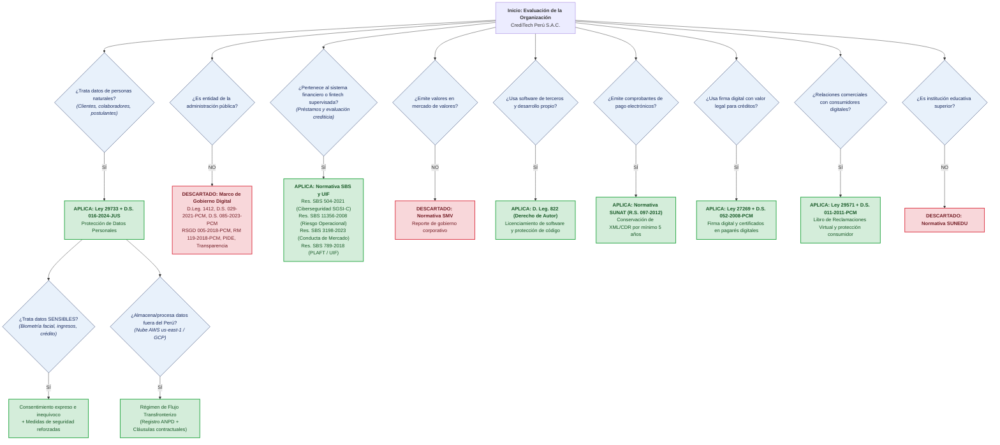

# Marco Normativo Aplicable: Determinación y Árbol de Decisión
## Código: NO01 · Determinación del Marco Regulatorio

---

### 1. Perfil y Naturaleza Jurídica de la Organización

| Atributo Institucional | Detalle de la Organización |
|---|---|
| **Razón Social** | CrediTech Perú S.A.C. |
| **RUC** | 20608945123 |
| **Naturaleza Jurídica** | Persona jurídica de derecho privado (Sociedad Anónima Cerrada) |
| **Sector Económico** | Sistema Financiero no bancario / Tecnología Financiera (*Fintech*) |
| **Actividad Principal** | Otorgamiento de microcréditos 100 % digitales mediante evaluación de riesgo crediticio automatizada (*scoring* algorítmico con Machine Learning), originación y desembolso digital de créditos, y gestión de cobranza. |
| **Dimensión y Estructura** | 64 colaboradores distribuidos en 4 áreas funcionales: Administración y Finanzas (18), Operaciones y Créditos (22), Ventas y Comercial (16) y TI (8). Más de 210,000 operaciones de crédito desembolsadas a nivel nacional. |
| **Infraestructura Tecnológica** | Arquitectura nativa en la nube (*Cloud Native*) desplegada en Amazon Web Services (AWS, región us-east-1 Norte de Virginia) y Google Cloud Platform (GCP, región us-central1 Iowa) para *datalake* y reentrenamiento analítico. |
| **Tipos de Datos Tratados** | **Datos Personales Generales:** Nombres, apellidos, documento de identidad (DNI/CE), número telefónico, correo electrónico, geolocalización de conexión, dirección y referencias familiares. **Datos Personales Sensibles:** Biometría facial (capturada durante el proceso de *onboarding* digital para verificación de identidad contra RENIEC), información de ingresos económicos, historial crediticio bancario y morosidad histórica. **Datos Internos:** Planillas laborales, cuentas bancarias de colaboradores, legajos de personal y datos de proveedores personas naturales. |

---

### 2. Aplicación del Árbol de Decisión Normativo

Se aplicó el árbol de decisión metodológico para evaluar la aplicabilidad regulatoria sobre las operaciones tecnológicas y de datos de **CrediTech Perú S.A.C.**:

---

### 3. Síntesis del Marco Aplicable

1. **Protección de Datos Personales (Ley 29733 y D.S. 016-2024-JUS):** La empresa realiza tratamiento automatizado intensivo de datos personales de cientos de miles de ciudadanos peruanos, incluyendo datos sensibles (biometría e ingresos). Obligación de registro ante la ANPD, Oficial de Protección de Datos (OPD), Evaluación de Impacto (EIPD) y régimen de flujo transfronterizo en la nube.
2. **Ciberseguridad y Riesgo Tecnológico Financiero (Res. SBS 504-2021, Res. SBS 11356-2008):** La plataforma opera desembolsos de dinero y custodia transaccional. Debe disponer de un SGSI-C (Sistema de Gestión de Seguridad de la Información y Ciberseguridad), Oficial CISO, *Ethical Hacking* periódico y planes de continuidad de negocio y recuperación ante desastres (BCP/DRP).
3. **Conducta de Mercado y Transparencia Algorítmica (Res. SBS 3198-2023):** Prohíbe sesgos y discriminación en los modelos de scoring, exigiendo explicabilidad para las decisiones automatizadas que rechacen créditos.
4. **Prevención del Lavado de Activos y Financiamiento del Terrorismo (Res. SBS 789-2018):** Obligación de monitoreo automatizado de operaciones no usuales y debida diligencia de conocimiento del cliente (KYC).
5. **Propiedad Intelectual y Software Legal (D. Leg. 822):** Prohibición terminante de uso de software sin licencia válida y protección de la autoría del core crediticio.
6. **Validez Legal de Contratación Electrónica (Ley 27269):** Otorgamiento de plena validez jurídica y no repudio a las solicitudes y pagarés suscritos con certificados digitales acreditados.
7. **Tributario Digital (R.S. 097-2012/SUNAT):** Emisión y custodia obligatoria e inmutable por 5 años de comprobantes electrónicos de pago y comisiones.
8. **Protección al Consumidor (Ley 29571):** Canal obligatorio del Libro de Reclamaciones Virtual con respuesta en máximo 15 días hábiles.

---

### 4. Normas Descartadas y Fundamentación Jurídico-Técnica

| Dispositivo Legal Descartado | Materia Regulada | Fundamento Técnico y Jurídico del Descarte |
|---|---|---|
| **D. Leg. N.° 1412** y **D.S. N.° 029-2021-PCM** | Ley de Gobierno Digital y su Reglamento | **No aplicable por el alcance subjetivo de la norma.** El Art. 2 del D. Leg. 1412 establece que la norma rige con carácter obligatorio para las entidades de la Administración Pública señaladas en el Art. I del Título Preliminar de la Ley 27444. CrediTech Perú S.A.C. es una persona jurídica privada sujeta al régimen societario mercantil. |
| **D.S. N.° 085-2023-PCM** | Política Nacional de Transformación Digital al 2030 | **No aplicable como mandato coercitivo.** Constituye un instrumento multisectorial de política pública de alcance nacional que fija metas para el Estado peruano, sin imponer sanciones operativas directas a personas jurídicas de derecho privado. |
| **RSGD N.° 005-2018-PCM/SEGDI** | Lineamientos para el Plan de Gobierno Digital (PGD) | **No aplicable.** Regula la formulación técnica obligatoria del PGD para entidades del sector público. La organización formula un PETI corporativo privado bajo marcos internacionales de la industria (COBIT 2019 e ISO/IEC 27001). |
| **RM N.° 119-2018-PCM** | Creación del Comité de Gobierno Digital y Líder de Gobierno Digital | **No aplicable.** Estructura de gobernanza exigible exclusivamente al aparato estatal. La empresa gobierna sus tecnologías mediante su Directorio, Comité de TI y las figuras de CISO y CIO. |
| **RSGTD N.° 003-2023-PCM/SGTD** | Uso obligatorio de la NTP-ISO/IEC 27001 en el Estado | **No aplicable la resolución administrativa.** Aunque la norma ISO/IEC 27001 se implementa en la organización como buena práctica y en cumplimiento de la Res. SBS 504-2021, la resolución de la SGTD aplica sólo a entidades públicas. |
| **Ley N.° 27806** | Ley de Transparencia y Acceso a la Información Pública | **No aplicable.** CrediTech Perú S.A.C. no administra fondos públicos ni presta servicios públicos en régimen de concesión monopólica; los derechos de acceso del usuario se ejercen por el régimen de derechos ARCO de la Ley 29733. |
| **Ley N.° 28716** | Ley de Control Interno de las Entidades del Estado | **No aplicable.** Marco de fiscalización y control gubernamental a cargo del Sistema Nacional de Control y la Contraloría General de la República sobre fondos públicos. |
| **Estándares de Interoperabilidad PIDE** | Plataforma de Interoperabilidad del Estado | **No aplicable como proveedor obligado.** La PIDE articula el intercambio de datos entre entidades públicas. La Fintech consume servicios de verificación de identidad mediante contratos comerciales y APIs privadas. |
| **Normativa SMV** | Mercado de Valores y Buen Gobierno Corporativo para emisores | **No aplicable.** CrediTech Perú S.A.C. no lista instrumentos de deuda ni acciones en la Bolsa de Valores de Lima (BVL) ni oferta públicamente valores mobiliarios. |
| **Normativa SUNEDU** | Ley Universitaria N.° 30220 y condiciones básicas | **No aplicable.** La empresa no brinda servicios educativos universitarios. |
