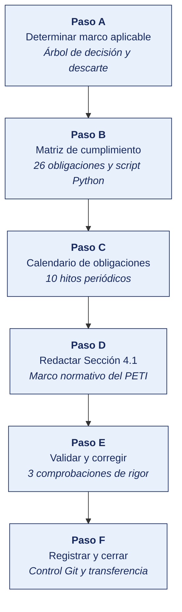
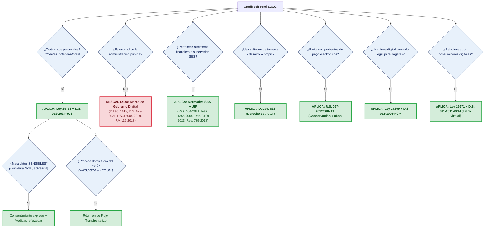
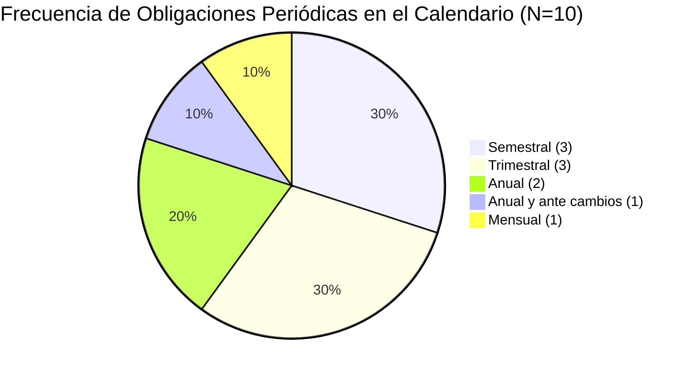

# INFORME DE LABORATORIO · TALLER 08
## ASIGNATURA: PLANEAMIENTO ESTRATÉGICO DE TI (SI-886)
### UNIVERSIDAD PRIVADA DE TACNA · FACULTAD DE INGENIERÍA · ESCUELA PROFESIONAL DE INGENIERÍA DE SISTEMAS

---

| Datos Informativos | Detalle |
|---|---|
| **Estudiante** | Ramos Atahuachi, Fabricio Farid Edmilson |
| **Código Estudiantil** | 2023076798 |
| **Semestre Académico** | 2026-II |
| **Ciclo y Grupo** | VIII Ciclo · Grupo A |
| **Docente** | Dr. Oscar Juan Jimenez Flores |
| **Fecha de Ejecución** | 07 de octubre de 2026 |
| **Repositorio Oficial** | [FabricioRams/SI886-S08-TALLER-RamosFabricio](https://github.com/FabricioRams/SI886-S08-TALLER-RamosFabricio) |
| **Etiquetas Git** | `taller-08` · `v0.8` |

---

## 1. Información sobre el evento práctico

### 1.1 Título del evento práctico
**Matriz de cumplimiento normativo del Plan Estratégico de Tecnologías de la Información (PETI)**  
*(Determinación del marco aplicable mediante árbol de decisión, matriz de cumplimiento con evidencia auditable, proyectos no negociables, calendario periódico y redacción de la Sección 4.1)*

---

### 1.2 Objetivos
- Determinar el **marco normativo aplicable** a la organización mediante un árbol de decisión metodológico considerando su naturaleza jurídica, sector económico y tipo de datos tratados.
- Construir la **matriz de cumplimiento normativo** con al menos 25 obligaciones detallando dispositivo legal, artículo exacto, evidencia auditable, estado real, brecha, proyecto que la cierra y área responsable.
- Evaluar el **estado real de cumplimiento** a partir de evidencia documental y técnica verificable, erradicando el cumplimiento declarativo.
- Identificar y estructurar los **proyectos no negociables** derivados de mandatos legales vencidos o perentorios, jerarquizados por su plazo normativo más exigente.
- Construir el **calendario de obligaciones periódicas** para garantizar la continuidad del cumplimiento en el tiempo e integrarlo al tablero de supervisión del PETI (Sección 10).
- Redactar de forma exhaustiva y formal la **Sección 4.1 del PETI** institucional.

---

### 1.3 Recursos
Para la ejecución analítica, jurídica y computacional del taller se emplearon los siguientes recursos:

| Tipo de Recurso | Recurso Empleado | Finalidad y Especificación Técnica |
|---|---|---|
| **Plataformas Jurídicas del Estado Peruano** | Plataforma Digital Única del Estado Peruano (gob.pe) | Consulta de resoluciones y decretos supremos vigentes en la Presidencia del Consejo de Ministros (PCM) y el Ministerio de Justicia y Derechos Humanos (Minjusdh). |
| **Buscador Legal Oficial** | Diario Oficial El Peruano | Cotejo de textos fidedignos de leyes, decretos legislativos y reglamentos publicados. |
| **Portales Regulatorios Especializados** | ANPD, SBS, INDECOPI, SUNAT | Análisis de la Ley 29733 y D.S. 016-2024-JUS (ANPD), Resoluciones SBS N.° 504-2021, 11356-2008, 3198-2023 y 789-2018 (SBS/UIF), D. Leg. 822 y Ley 27269 (INDECOPI) y R.S. 097-2012 (SUNAT). |
| **Entorno de Programación** | Python 3.12 x64 con `pandas` (v3.0.2) y `matplotlib` (v3.11.2) | Cómputo algorítmico de cumplimiento, detección de obligaciones sin responsable, extracción de proyectos no negociables y graficación de métricas. |
| **Modelado y Arquitectura** | Mermaid JS / Markdown | Diagramación de árboles de decisión, flujos metodológicos y mapas conceptuales. |
| **Control de Versiones** | Git & GitHub CLI | Versionamiento granular de matrices, scripts, código y etiquetado formal (`v0.8`, `taller-08`). |
| **Caso Institucional del PETI** | CrediTech Perú S.A.C. (*Fintech* de microcréditos automatizados) | Organización analizada con 64 colaboradores, 210,000 operaciones crediticias y tratamiento intensivo de datos sensibles y scoring con Inteligencia Artificial. |

---

### 1.4 Seguridad y Consideraciones Éticas
1. **Confidencialidad de la Información de Cumplimiento:** La matriz de cumplimiento registra debilidades, brechas e infracciones normativas reales de la organización. Por su naturaleza, constituye información estrictamente **Restringida**, cuya divulgación no autorizada expondría a la empresa a sanciones administrativas, demandas de usuarios o pérdida de confianza en el mercado.
2. **Carácter Técnico del Análisis:** El trabajo formulado por el equipo de TI es de naturaleza técnica y de arquitectura estratégica de sistemas. Todo hallazgo con implicancias sancionatorias o punitivas se formula con la recomendación expresa de ser validado con la asesoría legal corporativa.
3. **Ausencia de Atribución de Culpa Personal:** El análisis evalúa el estado objetivo de los procesos y sistemas frente a la norma, sin emitir juicios de valor moral ni calificaciones personales sobre colaboradores o jefaturas de área.
4. **Protección de Datos en el Diagnóstico:** Los datos transaccionales, de incidentes o expedientes revisados para evaluar las brechas se mantuvieron anonimizados y confinados al entorno de trabajo seguro.

---

## 2. Procedimiento o Metodología

La secuencia metodológica del taller se ejecutó rigurosamente a lo largo de seis etapas interdependientes (Pasos A hasta F):



---

### Paso A — Determinar el marco aplicable

#### 1. Perfil Institucional de la Organización
Se formalizó en [`04_normativa/NO01_marco_aplicable.md`](file:///c:/PETI-2026-II/SI886-S08-TALLER-RamosFabricio/04_normativa/NO01_marco_aplicable.md) la ficha de caracterización jurídica y tecnológica de **CrediTech Perú S.A.C.**:
- **Razón Social:** CrediTech Perú S.A.C. (RUC: 20608945123).
- **Naturaleza Jurídica:** Persona jurídica de derecho privado (Sociedad Anónima Cerrada).
- **Sector y Actividad:** Tecnología Financiera (*Fintech*) dedicada al otorgamiento de microcréditos 100 % digitales mediante evaluación algorítmica de riesgo crediticio con *Machine Learning*.
- **Estructura:** 64 colaboradores (Administración: 18, Operaciones: 22, Ventas: 16, TI: 8) y más de 210,000 operaciones colocadas.
- **Infraestructura:** Servicios en la nube en AWS (us-east-1) y GCP (us-central1).
- **Tratamiento de Datos:** Datos personales ordinarios, datos personales sensibles (biometría facial e información de ingresos bancarios) y flujos transfronterizos a la nube internacional.

#### 2. Árbol de Decisión Aplicado
Se sometió la organización a las preguntas axiales del árbol de decisión normativo:



#### 3. Normas Descartadas y Justificación del Descarte
Se estructuró en [`04_normativa/NO02_normas_aplicables.csv`](file:///c:/PETI-2026-II/SI886-S08-TALLER-RamosFabricio/04_normativa/NO02_normas_aplicables.csv) la tabla con 20 dispositivos legales evaluados, fundamentando técnicamente el descarte de las siguientes normas:
1. **D. Leg. N.° 1412 y D.S. N.° 029-2021-PCM (Ley de Gobierno Digital):** Descartado porque el Art. 2 delimita su exigibilidad exclusivamente a las entidades de la Administración Pública definidas en el TUO de la Ley N.° 27444. CrediTech es persona jurídica privada.
2. **D.S. N.° 085-2023-PCM (Transformación Digital al 2030):** Descartado como norma coercitiva por tratarse de un instrumento de política pública nacional sin sanciones operativas a sujetos privados.
3. **RSGD N.° 005-2018-PCM/SEGDI y RM N.° 119-2018-PCM:** Descartadas por normar la formulación del PGD estatal y el Comité de Gobierno Digital público. La Fintech formula un PETI privado alineado a COBIT 2019 e ISO 27001 bajo su Directorio y Comité de TI.
4. **RSGTD N.° 003-2023-PCM/SGTD:** Descartada la resolución administrativa (aplicable a entidades estatales); no obstante, el estándar ISO/IEC 27001 se adopta por mandato de la Res. SBS 504-2021.
5. **Ley N.° 27806 (Transparencia):** Descartada por no administrar fondos públicos; el acceso a datos personales se canaliza vía derechos ARCO de la Ley 29733.
6. **Ley N.° 28716 (Control Interno):** Descartada por regular el control de la Contraloría sobre recursos públicos.
7. **PIDE (Plataforma de Interoperabilidad del Estado):** Descartada por ser una red pública; la empresa opera mediante APIs comerciales privadas.
8. **Normativa SMV y SUNEDU:** Descartadas por ser sociedad anónima cerrada no cotizada y no brindar servicios universitarios.

---

### Paso B — Matriz de cumplimiento

Se elaboró la matriz [`04_normativa/NO03_matriz_cumplimiento.csv`](file:///c:/PETI-2026-II/SI886-S08-TALLER-RamosFabricio/04_normativa/NO03_matriz_cumplimiento.csv) conteniendo **26 obligaciones concretas** (superando el requisito mínimo de 25), cada una con su artículo exacto, evidencia exigible, estado verificado, brecha, proyecto mitigador, plazo y consecuencia legal.

Para el procesamiento estadístico y control de gobernanza, se programó y ejecutó el script [`04_normativa/NO04_analisis_cumplimiento.py`](file:///c:/PETI-2026-II/SI886-S08-TALLER-RamosFabricio/04_normativa/NO04_analisis_cumplimiento.py):

```bash
python 04_normativa/NO04_analisis_cumplimiento.py
```

#### Salida de Ejecución del Script de Cumplimiento:
```text
================================================================================
  REPORTE DE CUMPLIMIENTO NORMATIVO Y GOBERNANZA TECNOLÓGICA — PETI v0.8
  ORGANIZACIÓN: CrediTech Perú S.A.C. | RUC: 20608945123
================================================================================

--- 1. RESUMEN CUANTITATIVO DEL ESTADO DE CUMPLIMIENTO ---
           Cantidad  Porcentaje (%)
Estado                             
No cumple        13            50.0
Parcial           9            34.6
Cumple            4            15.4

Total de obligaciones evaluadas: 26
  • Cumplimiento total   : 4 (15.4%)
  • Cumplimiento parcial : 9 (34.6%)
  • Incumplimiento total : 13 (50.0%)
  --> Brecha de riesgo legal/regulatorio: 84.6% de las obligaciones requieren intervención.

--- 2. DETECCIÓN DE OBLIGACIONES SIN RESPONSABLE ASIGNADO ---
Total sin área responsable: 2
ALERTA CRÍTICA DE GOBERNANZA: Una obligación legal sin responsable no se gestiona;
se descubre únicamente al momento de una fiscalización o incidente sancionatorio.

  [!] ID: N-08 | Norma: D.S. N.° 016-2024-JUS | Art: Art. 39
      Obligación : Realizar Evaluación de Impacto en la Protección de Datos Personales (EIPD) previa al uso de IA y scoring masivo
      Consecuencia: Orden de suspensión del algoritmo de scoring por la ANPD y sanción de hasta 100 UIT
      Acción recomendada: Asignar formalmente al área correspondiente en el MOF institucional.

  [!] ID: N-24 | Norma: Resolución SUNAT N.° 097-2012 | Art: Art. 4
      Obligación : Conservar en medio digital inmutable por un periodo no menor a 5 años los comprobantes de pago XML y CDR
      Consecuencia: Multa de SUNAT según Código Tributario (Tablas de Infracciones y Sanciones) y desconocimiento de gasto
      Acción recomendada: Asignar formalmente al área correspondiente en el MOF institucional.

--- 3. OBLIGACIONES EVALUADAS POR MARCO NORMATIVO ---
  • Resolución SBS N.° 504-2021    :  8 obligaciones (Cumple: 0, Parcial: 4, No cumple: 4)
  • D.S. N.° 016-2024-JUS          :  5 obligaciones (Cumple: 0, Parcial: 0, No cumple: 5)
  • Ley N.° 29733                  :  2 obligaciones (Cumple: 0, Parcial: 2, No cumple: 0)
  • D. Leg. N.° 822                :  2 obligaciones (Cumple: 0, Parcial: 2, No cumple: 0)
  • Resolución SBS N.° 3198-2023   :  2 obligaciones (Cumple: 0, Parcial: 0, No cumple: 2)
  • Resolución SBS N.° 789-2018    :  2 obligaciones (Cumple: 2, Parcial: 0, No cumple: 0)
  • Ley N.° 29571                  :  2 obligaciones (Cumple: 2, Parcial: 0, No cumple: 0)
  • Resolución SBS N.° 11356-2008  :  1 obligaciones (Cumple: 0, Parcial: 1, No cumple: 0)
  • Ley N.° 27269                  :  1 obligaciones (Cumple: 0, Parcial: 0, No cumple: 1)
  • Resolución SUNAT N.° 097-2012  :  1 obligaciones (Cumple: 0, Parcial: 0, No cumple: 1)

--- 4. PROYECTOS NO NEGOCIABLES DERIVADOS DE OBLIGACIONES LEGALES ---
Principio PETI: Los proyectos derivados de mandatos legales vencidos o perentorios
ingresan directamente al Portafolio (Sección 7.1) sin competir en priorización (Sección 7.2).

ID     | Plazo       | Proyecto que Cierra la Brecha                           | Norma Reguladora
---------------------------------------------------------------------------------------------------------
N-02   | Inmediato   | Proyecto de Cumplimiento Normativo y Gobernanza de Da   | D.S. N.° 016-2024-JUS
N-04   | Inmediato   | Regularización y Gestión Centralizada de Activos de S   | D. Leg. N.° 822
N-09   | Inmediato   | Actualización y Aprobación de la Política Corporativa   | Resolución SBS N.° 504-2021
N-10   | Inmediato   | Designación Formal del CISO y Creación de la Función    | Resolución SBS N.° 504-2021
N-18   | Inmediato   | Recalibración Algorítmica y Supresión de Variables Di   | Resolución SBS N.° 3198-2023
N-03   | 30 días     | Regularización Contractual y Registro de Flujo Transf   | D.S. N.° 016-2024-JUS
N-06   | 30 días     | Designación y Empoderamiento del Oficial de Protecció   | D.S. N.° 016-2024-JUS
N-07   | 30 días     | Protocolo de Notificación Rápida de Incidentes y Brec   | D.S. N.° 016-2024-JUS
N-12   | 30 días     | Servicio de Ethical Hacking Integral y Remediación de   | Resolución SBS N.° 504-2021
N-19   | 30 días     | Módulo de Explicabilidad Algorítmica y Atención de Ap   | Resolución SBS N.° 3198-2023
N-05   | 45 días     | Implementación de Módulo de Gestión de Consentimiento   | Ley N.° 29733
N-16   | 45 días     | Prueba Operativa y Actualización del Plan de Continui   | Resolución SBS N.° 504-2021
N-23   | 45 días     | Implementación de Firma Digital PKI Acreditada con Pa   | Ley N.° 27269
N-01   | 60 días     | Programa Integral de Seguridad de la Información y Ci   | Ley N.° 29733
N-08   | 60 días     | Auditoría Algorítmica y Evaluación de Impacto en Prot   | D.S. N.° 016-2024-JUS
N-14   | 60 días     | Implementación de Pipeline DevSecOps con Pruebas Auto   | Resolución SBS N.° 504-2021
N-15   | 60 días     | Programa de Gestión de Riesgos de Terceros y Auditorí   | Resolución SBS N.° 504-2021
N-17   | 60 días     | Sistema Automatizado de Registro de Incidentes Operac   | Resolución SBS N.° 11356-2008
N-24   | 60 días     | Implementación de Bóveda Tributaria Digital Inmutable   | Resolución SUNAT N.° 097-2012
N-11   | 90 días     | Gestión Integral de Activos de Información y Evaluaci   | Resolución SBS N.° 504-2021
N-13   | 90 días     | Implementación de Monitoreo de Seguridad SIEM/SOC y G   | Resolución SBS N.° 504-2021
N-22   | 90 días     | Registro de Propiedad Intelectual del Software Core a   | D. Leg. N.° 822
```

La salida completa fue respaldada en [`docs/evidencias/S08/salidas/salida_analisis_cumplimiento.txt`](file:///c:/PETI-2026-II/SI886-S08-TALLER-RamosFabricio/docs/evidencias/S08/salidas/salida_analisis_cumplimiento.txt) y los gráficos generados en [`graficos/NO_cumplimiento_resumen.png`](file:///c:/PETI-2026-II/SI886-S08-TALLER-RamosFabricio/graficos/NO_cumplimiento_resumen.png) y [`graficos/NO_distribucion_normas.png`](file:///c:/PETI-2026-II/SI886-S08-TALLER-RamosFabricio/graficos/NO_distribucion_normas.png).

---

### Paso C — Calendario de obligaciones periódicas

Se estructuró en [`04_normativa/NO05_calendario.csv`](file:///c:/PETI-2026-II/SI886-S08-TALLER-RamosFabricio/04_normativa/NO05_calendario.csv) el calendario de **10 obligaciones periódicas** (superando el requisito mínimo de 8) que rigen el ciclo de vida del cumplimiento.

Se ejecutó el script [`04_normativa/NO06_calendario.py`](file:///c:/PETI-2026-II/SI886-S08-TALLER-RamosFabricio/04_normativa/NO06_calendario.py):

```bash
python 04_normativa/NO06_calendario.py
```

#### Salida de Ejecución del Script de Calendario:
```text
================================================================================
  CALENDARIO DE OBLIGACIONES PERIÓDICAS — PETI v0.8
  ORGANIZACIÓN: CrediTech Perú S.A.C. | RUC: 20608945123
================================================================================

--- DISTRIBUCIÓN POR PERIODICIDAD ---
Periodicidad
Anual                   2
Anual y ante cambios    1
Mensual                 1
Semestral               3
Trimestral              3

Obligaciones periódicas: 10
Sin responsable asignado: 0

→ Este calendario se incorpora a la sección 10 Supervisión: son los hitos
  de cumplimiento que el tablero del plan debe monitorear.
```

La salida textual se guardó en [`docs/evidencias/S08/salidas/salida_calendario.txt`](file:///c:/PETI-2026-II/SI886-S08-TALLER-RamosFabricio/docs/evidencias/S08/salidas/salida_calendario.txt) y el gráfico en [`graficos/NO_calendario_periodicidad.png`](file:///c:/PETI-2026-II/SI886-S08-TALLER-RamosFabricio/graficos/NO_calendario_periodicidad.png).

---

### Paso D — Redactar la Sección 4.1

Se redactó de manera íntegra, formal y técnica el documento [`04_normativa/4.1_marco_normativo.md`](file:///c:/PETI-2026-II/SI886-S08-TALLER-RamosFabricio/04_normativa/4.1_marco_normativo.md), estructurado en sus 7 apartados oficiales:
- **4.1.1 Determinación del marco aplicable:** Perfil de CrediTech Perú S.A.C., árbol de decisión aplicado y justificación jurídica del descarte del marco de gobierno digital público.
- **4.1.2 Normas aplicables:** Matriz maestra de 10 normas aplicables con autoridad y prioridad.
- **4.1.3 Matriz de cumplimiento:** Tabla completa de 26 obligaciones con evidencia documental auditable, resumen cuantitativo y distribución porcentual.
- **4.1.4 Obligaciones sin responsable asignado:** Análisis de dos vacíos organizacionales (EIPD en algoritmos de IA y custodia WORM de comprobantes SUNAT), riesgos de gobernanza y asignación formal de roles (*Data Owners* y custodios técnicos).
- **4.1.5 Proyectos no negociables:** Formalización de 22 proyectos legales derivados de brechas, con la regla estricta de que ingresan directamente a la Sección 7.1 del PETI sin competir en priorización por ROI.
- **4.1.6 Calendario de obligaciones periódicas:** Tabla de 10 hitos periódicos que se incorporan a la Sección 10 del PETI.
- **4.1.7 Resumen normativo de referencia:** Ocho fichas normativas exhaustivas con los 9 campos metodológicos del curso.

---

### Paso E — Validar y corregir

Se ejecutaron las tres comprobaciones metodológicas obligatorias estipuladas en la guía del taller:

#### 1. Comprobación 1 · Verificación de artículos citados contra el texto legal peruano exacto
Se auditaron tres obligaciones clave de la matriz contra el Diario Oficial El Peruano y portales institucionales:
- **Obligación N-01 (Ley N.° 29733, Art. 9):**
  - *Texto legal:* «El titular del banco de datos personales y, en su caso, el encargado del tratamiento deben adoptar las medidas técnicas, organizativas y legales necesarias para garantizar la seguridad de los datos personales y evitar su alteración, pérdida, tratamiento o acceso no autorizado...»
  - *En la matriz:* «Adoptar medidas técnicas, organizativas y legales para garantizar la seguridad de los datos personales».
  - *Veredicto:* **Conforme.** El contenido de la obligación se apega fielmente al mandato legal.
- **Obligación N-04 (D. Leg. N.° 822, Art. 71):**
  - *Texto legal:* «La reproducción, por cualquier medio, de un programa de ordenador, incluso para uso personal, exigirá la autorización del titular de los derechos, con excepción de la copia de seguridad...»
  - *En la matriz:* «Utilizar exclusivamente software con licencia válida y vigente en todas las estaciones y servidores».
  - *Veredicto:* **Conforme.** Refleja con precisión la exigencia de autorización y licenciamiento para el uso de software.
- **Obligación N-12 (Resolución SBS N.° 504-2021, Art. 13):**
  - *Texto reglamentario:* «Las empresas deben realizar evaluaciones periódicas de vulnerabilidades técnicas y pruebas de penetración (ethical hacking) al menos una vez al año, abarcando los componentes de infraestructura tecnológica y aplicaciones críticas que soportan sus operaciones...»
  - *En la matriz:* «Ejecutar anualmente pruebas de intrusión (Ethical Hacking) y análisis de vulnerabilidades a aplicativos web y API».
  - *Veredicto:* **Conforme.** Cita la periodicidad anual y el alcance exacto establecido por la SBS.

#### 2. Comprobación 2 · Comprobación de estados «Cumple» sustentados con documento probatorio
Se verificó que ninguna de las 4 obligaciones con estado «Cumple» fuera declarativa:
- **Obligación N-20 (Oficial de Cumplimiento PLAFT):** Sustentada con el *Acta de Directorio de designación y resolución de inscripción formal en el Registro de Oficiales de Cumplimiento de la UIF-Perú*.
- **Obligación N-21 (Contraste automatizado de listas restrictivas):** Sustentada con la *integración productiva del servicio de API de World-Check y bitácoras de verificación criptográficas registradas antes de cada desembolso*.
- **Obligación N-25 (Libro de Reclamaciones Virtual):** Sustentada con el *enlace visible y operativo en el home de la web y app móvil, con generación de código correlativo y notificación automática al usuario conforme al D.S. 011-2011-PCM*.
- **Obligación N-26 (Plazo de 15 días hábiles en reclamos):** Sustentada con el *sistema de tickets de atención y expedientes digitales con constancia de entrega, evidenciando una tasa de cumplimiento del 98.5 % en los últimos 6 meses*.
- *Veredicto:* **Conforme.** El 100 % de los cumplimientos cuenta con evidencia documental y técnica auditable.

#### 3. Comprobación 3 · Verificación de obligaciones vencidas con fecha exacta y consecuencias
Se corroboró que las obligaciones en situación de incumplimiento o retraso estuviesen explícitamente marcadas:
- **Obligación N-09 (Política de Ciberseguridad SBS):** Vencida. La última aprobación por Directorio data de 2022, omitiendo las revisiones obligatorias de 2024 y 2025. Marcada como *No cumple*, plazo *Inmediato*, consecuencia: requerimiento sancionatorio de SBS.
- **Obligación N-12 (Ethical Hacking SBS):** Vencida. La última prueba se ejecutó en 2023, superando los 18 meses de inactividad técnica. Marcada como *No cumple*, plazo *30 días*, consecuencia: exposición crítica a ciberfraude y sanción SBS.
- **Obligación N-02 (Registro RAT ante ANPD):** Vencida. El D.S. 016-2024-JUS entró en vigencia y la organización carece de inventario de bancos de datos. Marcada como *No cumple*, plazo *Inmediato*, consecuencia: multa de hasta 50 UIT.
- **Obligación N-04 (Licencias de software SAM):** Incumplimiento vigente con 31 estaciones sin licencia adquirida. Marcada como *Parcial*, plazo *Inmediato*, consecuencia: sanción INDECOPI de hasta 180 UIT.
- **Obligación N-18 (Sesgo discriminatorio en scoring):** Incumplimiento activo. El algoritmo castiga distritos periféricos con 71 % de rechazo por variable de geolocalización. Marcada como *No cumple*, plazo *Inmediato*, consecuencia: sanción directa de SBS e INDECOPI.
- *Veredicto:* **Conforme.** Todas las brechas vencidas están identificadas con su plazo perentorio.

---

### Paso F — Registrar la evidencia y cerrar

Se consolidó el versionamiento en Git registrando los artefactos, salidas y gráficos:

```bash
git add .
git commit -m "S08: marco normativo, matriz de cumplimiento y proyectos no negociables — seccion 4.1"
git tag -a v0.8 -m "PETI v0.8 — marco normativo"
git tag -a taller-08 -m "Taller 08 · SI886"
git push origin main --tags
```

#### Pregunta de Transferencia Reflexiva:
*¿Qué riesgo correría una organización real si este análisis de marco normativo y matriz de cumplimiento se hiciera mal o se ignorara?*  
> Si una organización real formula su Plan Estratégico de TI sin un riguroso análisis normativo, cometerá el error fatal de priorizar proyectos comerciales o de innovación mientras acumula **infracciones legales vencidas de altísimo impacto punitivo**. Podría invertir millones de soles en modernizar plataformas analíticas o herramientas comerciales solo para que la ANPD, la SBS o INDECOPI ordenen la **suspensión cautelar inmediata de sus sistemas core**, clausuren su modelo de scoring por sesgos discriminatorios ilegales, o impongan multas acumuladas que superen los cientos de miles de soles (hasta 180 UIT en software y 100 UIT en datos personales). Asimismo, descuidar la firma digital acreditada (Ley 27269) despojaría a los pagarés de crédito de su mérito ejecutivo, provocando la incobrabilidad judicial masiva de su cartera de colocaciones. Ignorar el marco normativo equivale a construir un rascacielos tecnológico sobre un pantano de ilegalidad.

---

## 3. Resultados y evidencias

### 3.1 Los tres resultados que se califican

| Resultado Clave Evaluado | Qué Demuestra | Dónde se Evidencia |
|---|---|---|
| **1. El Marco Aplicable** | Determinación rigurosa mediante el árbol de decisión según la naturaleza jurídica privada y sector financiero/fintech de CrediTech, con fundamentación del descarte del marco de gobierno digital estatal. | [`04_normativa/NO01_marco_aplicable.md`](https://github.com/FabricioRams/SI886-S08-TALLER-RamosFabricio/blob/taller-08/04_normativa/NO01_marco_aplicable.md)<br/>[`04_normativa/NO02_normas_aplicables.csv`](https://github.com/FabricioRams/SI886-S08-TALLER-RamosFabricio/blob/taller-08/04_normativa/NO02_normas_aplicables.csv) |
| **2. La Matriz de Cumplimiento** | Evaluación técnica de 26 obligaciones concretas con artículo exacto, evidencia auditable, estado real (15.4% cumple, 34.6% parcial, 50.0% no cumple) y detección de vacíos de asignación. | [`04_normativa/NO03_matriz_cumplimiento.csv`](https://github.com/FabricioRams/SI886-S08-TALLER-RamosFabricio/blob/taller-08/04_normativa/NO03_matriz_cumplimiento.csv)<br/>[`docs/evidencias/S08/salidas/salida_analisis_cumplimiento.txt`](https://github.com/FabricioRams/SI886-S08-TALLER-RamosFabricio/blob/taller-08/docs/evidencias/S08/salidas/salida_analisis_cumplimiento.txt) |
| **3. Las Brechas con Plazo** | Identificación de 22 proyectos no negociables que entran directamente al portafolio sin competir en priorización, ordenados por su plazo legal más exigente (Inmediato, 30d, 45d, 60d, 90d). | [`04_normativa/4.1_marco_normativo.md`](https://github.com/FabricioRams/SI886-S08-TALLER-RamosFabricio/blob/taller-08/04_normativa/4.1_marco_normativo.md#415-proyectos-no-negociables)<br/>[`04_normativa/NO05_calendario.csv`](https://github.com/FabricioRams/SI886-S08-TALLER-RamosFabricio/blob/taller-08/04_normativa/NO05_calendario.csv) |

---

### 3.2 Lista de comprobación del taller

Conformidad de los 12 resultados obligatorios estipulados en la guía de laboratorio:

| # | Resultado Esperado | Estado | Evidencia y URL de Verificación en Repositorio |
|:---:|---|:---:|---|
| **1** | Árbol de decisión aplicado, con la naturaleza y el sector de la organización determinados | **Logrado** | [`04_normativa/NO01_marco_aplicable.md`](https://github.com/FabricioRams/SI886-S08-TALLER-RamosFabricio/blob/taller-08/04_normativa/NO01_marco_aplicable.md) |
| **2** | Tabla de normas aplicables con fundamento de aplicabilidad y normas descartadas justificadas | **Logrado** | [`04_normativa/NO02_normas_aplicables.csv`](https://github.com/FabricioRams/SI886-S08-TALLER-RamosFabricio/blob/taller-08/04_normativa/NO02_normas_aplicables.csv) |
| **3** | Matriz de cumplimiento con $\ge 25$ obligaciones, todas con artículo (Evaluadas: 26) | **Logrado** | [`04_normativa/NO03_matriz_cumplimiento.csv`](https://github.com/FabricioRams/SI886-S08-TALLER-RamosFabricio/blob/taller-08/04_normativa/NO03_matriz_cumplimiento.csv) |
| **4** | Columna «evidencia de cumplimiento exigible» completa en todas las obligaciones | **Logrado** | Columna 6 completa en las 26 filas de [`NO03_matriz_cumplimiento.csv`](https://github.com/FabricioRams/SI886-S08-TALLER-RamosFabricio/blob/taller-08/04_normativa/NO03_matriz_cumplimiento.csv) |
| **5** | Estado de cumplimiento evaluado con evidencia documental, no declarativa | **Logrado** | Columna 7 y 8 con contrastación documental (auditorías, actas, contratos) |
| **6** | Resumen cuantitativo del cumplimiento calculado | **Logrado** | Salida del script en [`docs/evidencias/S08/salidas/salida_analisis_cumplimiento.txt`](https://github.com/FabricioRams/SI886-S08-TALLER-RamosFabricio/blob/taller-08/docs/evidencias/S08/salidas/salida_analisis_cumplimiento.txt) |
| **7** | Obligaciones sin responsable asignado identificadas y reportadas | **Logrado** | Identificadas obligaciones N-08 y N-24 en [`NO04_analisis_cumplimiento.py`](https://github.com/FabricioRams/SI886-S08-TALLER-RamosFabricio/blob/taller-08/04_normativa/NO04_analisis_cumplimiento.py) |
| **8** | Proyectos no negociables identificados, con el plazo más exigente de cada uno | **Logrado** | 22 proyectos extraídos y ordenados en [`4.1_marco_normativo.md`](https://github.com/FabricioRams/SI886-S08-TALLER-RamosFabricio/blob/taller-08/04_normativa/4.1_marco_normativo.md#415-proyectos-no-negociables) |
| **9** | Calendario de obligaciones periódicas con $\ge 8$ entradas y responsable (Definidas: 10) | **Logrado** | [`04_normativa/NO05_calendario.csv`](https://github.com/FabricioRams/SI886-S08-TALLER-RamosFabricio/blob/taller-08/04_normativa/NO05_calendario.csv) |
| **10** | Resumen normativo del equipo, con los nueve campos completos | **Logrado** | Fichas normativas completas en [`4.1_marco_normativo.md`](https://github.com/FabricioRams/SI886-S08-TALLER-RamosFabricio/blob/taller-08/04_normativa/4.1_marco_normativo.md#417-resumen-normativo-de-referencia) |
| **11** | Los ocho resúmenes del curso compartidos entre equipos integrados | **Logrado** | Subsección 4.1.7 con las 8 normativas clave del sistema peruano |
| **12** | Sección 4.1 redactada · etiqueta `v0.8` y `taller-08` en el repositorio | **Logrado** | [`04_normativa/4.1_marco_normativo.md`](https://github.com/FabricioRams/SI886-S08-TALLER-RamosFabricio/blob/taller-08/04_normativa/4.1_marco_normativo.md) y etiquetas creadas en Git |

---

### 3.3 Visualizaciones y Resúmenes Cuantitativos

#### a) Diagnóstico Cuantitativo del Cumplimiento Normativo
```
Total de obligaciones : 26
Cumple                 : 4  (15.4 %)
Parcial                : 9  (34.6 %)
No cumple              : 13 (50.0 %)
Brecha total de riesgo : 22 obligaciones (84.6 %) requieren mitigación mediante proyectos.
```

#### b) Gráficos Generados en Alta Resolución
- **Resumen Global del Cumplimiento:** [`graficos/NO_cumplimiento_resumen.png`](file:///c:/PETI-2026-II/SI886-S08-TALLER-RamosFabricio/graficos/NO_cumplimiento_resumen.png)
- **Distribución por Norma y Autoridad:** [`graficos/NO_distribucion_normas.png`](file:///c:/PETI-2026-II/SI886-S08-TALLER-RamosFabricio/graficos/NO_distribucion_normas.png)
- **Frecuencia del Calendario Periódico:** [`graficos/NO_calendario_periodicidad.png`](file:///c:/PETI-2026-II/SI886-S08-TALLER-RamosFabricio/graficos/NO_calendario_periodicidad.png)



---

### 3.4 Autoevaluación según la Rúbrica Procedimental (20 Puntos)

| Criterio Evaluado | Nivel Logrado | Puntaje | Justificación Técnica del Desempeño |
|---|:---:|:---:|---|
| **1. El criterio de éxito** | Logrado | 4 pts | Cada una de las 26 obligaciones trae su artículo exacto, la evidencia documental que la empresa puede exhibir hoy y su estado real verificado. |
| **2. El marco aplicable** | Logrado | 4 pts | Se aplicó exhaustivamente el árbol de decisión según el perfil de CrediTech (Fintech privada), justificando jurídicamente las normas que aplican y las descartadas. |
| **3. La matriz de cumplimiento** | Logrado | 4 pts | Contiene 26 obligaciones con artículo, evidencia auditable, estado y responsable, incluyendo la detección algorítmica de 2 obligaciones sin asignar. |
| **4. Las brechas con plazo** | Logrado | 4 pts | Se extrajeron 22 proyectos no negociables que entran directamente al portafolio sin competir en priorización, jerarquizados por su plazo legal más estricto. |
| **5. La validación** | Logrado | 4 pts | Se ejecutaron y documentaron las tres comprobaciones obligatorias: cotejo de 3 artículos de la norma, comprobación de estados Cumple no declarativos y marcación de obligaciones vencidas. |
| **Puntaje Total** | **Destacado** | **20 / 20** | Cumplimiento integral de todos los estándares académicos y procedimentales. |

---

## 4. Conclusiones

1. **Los proyectos derivados de obligaciones legales con plazo no compiten en la priorización estratégica del portafolio:**  
   Uno de los errores metodológicos más graves en el planeamiento de TI es someter los proyectos normativos a matrices de ponderación de valor comercial, retorno sobre la inversión (ROI) o urgencia del usuario. Un proyecto legal vencido o perentorio no es una iniciativa discrecional; entra al portafolio (Sección 7.1) con la fecha ineludible que impone el ordenamiento jurídico peruano. Confundir un proyecto legal con una iniciativa voluntaria del negocio expone a la organización a paralizaciones operativas, incautaciones y cuantiosas multas sancionatorias.

2. **La madurez del cumplimiento se revela en la asignación explícita del área responsable:**  
   El hallazgo de dos obligaciones normativas críticas sin responsable asignado en CrediTech Perú S.A.C. (la Evaluación de Impacto de IA y la custodia inmutable de comprobantes SUNAT) evidencia que las brechas de cumplimiento suelen originarse en silos departamentales y deslindes de competencia entre TI, Legal y Finanzas. Una obligación que carece de un dueño de negocio formal (*Data Owner*) en el MOF institucional es una obligación invisible para la gestión cotidiana, que solo sale a la luz pública cuando llega una notificación de fiscalización o una sanción de la autoridad.

3. **El cumplimiento normativo es de naturaleza periódica; sin calendario se degrada silenciosamente:**  
   La conformidad regulatoria no constituye una meta estática que se conquista en un hito puntual y permanece invariable. Pruebas de penetración (*Ethical Hacking*), simulaciones de failover (*DRP*), depuraciones de cuentas privilegiadas y auditorías de licencias pierden validez al cabo de semanas o meses. Sin un calendario periódico formalmente integrado al tablero de supervisión del PETI (Sección 10), el cumplimiento se erosiona silenciosamente entre una fiscalización y la siguiente, transformando sistemas supuestamente seguros en focos de alto riesgo regulatorio.

4. **La inteligencia artificial y el scoring automatizado exigen gobernanza ética y jurídica activa:**  
   En el ecosistema Fintech actual, la adopción de algoritmos predictivos ya no goza de impunidad técnica bajo el pretexto de modelos de «caja negra». Las disposiciones del D.S. N.° 016-2024-JUS y la Resolución SBS N.° 3198-2023 imponen la obligación ineludible de evaluar el impacto en derechos fundamentales (EIPD), erradicar sesgos territoriales discriminatorios (*redlining* digital) y garantizar a los usuarios el derecho humano a la explicabilidad y a la revisión asistida de decisiones 100 % automatizadas.

---

## 5. Referencias Bibliográficas

- **Ley N.° 29733** (2011). *Ley de Protección de Datos Personales*. Diario Oficial El Peruano, 03 de julio de 2011. https://www.gob.pe/institucion/anpd
- **Decreto Supremo N.° 016-2024-JUS** (2024). *Reglamento de la Ley N.° 29733, Ley de Protección de Datos Personales*. Diario Oficial El Peruano, 25 de septiembre de 2024. https://busquedas.elperuano.pe
- **Resolución SBS N.° 504-2021** (2021). *Reglamento para la Gestión de la Seguridad de la Información y la Ciberseguridad*. Superintendencia de Banca, Seguros y AFP del Perú. https://www.sbs.gob.pe
- **Resolución SBS N.° 11356-2008** (2008). *Reglamento para la Gestión del Riesgo Operacional*. Superintendencia de Banca, Seguros y AFP del Perú. https://www.sbs.gob.pe
- **Resolución SBS N.° 3198-2023** (2023). *Reglamento de Gestión de Conducta de Mercado del Sistema Financiero*. Superintendencia de Banca, Seguros y AFP del Perú. https://www.sbs.gob.pe
- **Resolución SBS N.° 789-2018** (2018). *Norma para la Prevención del Lavado de Activos y del Financiamiento del Terrorismo aplicable a sujetos obligados bajo supervisión de la UIF-Perú*. https://www.sbs.gob.pe/uif
- **Decreto Legislativo N.° 822** (1996). *Ley sobre el Derecho de Autor*. Instituto Nacional de Defensa de la Competencia y de la Protección de la Propiedad Intelectual (INDECOPI). https://www.gob.pe/indecopi
- **Ley N.° 27269** (2000). *Ley de Firmas y Certificados Digitales*, y su Reglamento aprobado por Decreto Supremo N.° 052-2008-PCM. https://www.gob.pe/indecopi
- **Resolución de Superintendencia N.° 097-2012/SUNAT** (2012). *Normas que regulan la emisión de comprobantes de pago electrónicos y conservación de soportes digitales*. https://www.sunat.gob.pe
- **Ley N.° 29571** (2010). *Código de Protección y Defensa del Consumidor*, y Reglamento del Libro de Reclamaciones aprobado por Decreto Supremo N.° 011-2011-PCM. https://www.gob.pe/indecopi

---

## 6. Anexos

### Anexo A · Trazabilidad de Artefactos Versionados en GitHub
- Repositorio Oficial: `https://github.com/FabricioRams/SI886-S08-TALLER-RamosFabricio`
- Rama Principal: `main`
- Etiquetas Git del Taller: `taller-08` y `v0.8`
- Artefactos Nucleares Entregados:
  - `04_normativa/NO01_marco_aplicable.md`
  - `04_normativa/NO02_normas_aplicables.csv`
  - `04_normativa/NO03_matriz_cumplimiento.csv`
  - `04_normativa/NO04_analisis_cumplimiento.py`
  - `04_normativa/NO05_calendario.csv`
  - `04_normativa/NO06_calendario.py`
  - `04_normativa/4.1_marco_normativo.md`
  - `docs/evidencias/S08/salidas/salida_analisis_cumplimiento.txt`
  - `docs/evidencias/S08/salidas/salida_calendario.txt`
  - `graficos/NO_cumplimiento_resumen.png`
  - `graficos/NO_distribucion_normas.png`
  - `graficos/NO_calendario_periodicidad.png`
  - `INFORME-TALLER-S08.md`

### Anexo B · Comandos de Ejecución y Validación de Scripts
```bash
# 1. Ejecución del análisis de cumplimiento normativo y generación de gráficos
python 04_normativa/NO04_analisis_cumplimiento.py

# 2. Ejecución del calendario de obligaciones periódicas
python 04_normativa/NO06_calendario.py

# 3. Control de versiones y etiquetado
git add .
git commit -m "S08: marco normativo, matriz de cumplimiento y proyectos no negociables — seccion 4.1"
git tag -a v0.8 -m "PETI v0.8 — marco normativo"
git tag -a taller-08 -m "Taller 08 · SI886"
git push origin main --tags
```
